<!-- SPDX-License-Identifier: MIT -->
# Copal — feature guide

A tour of Copal in pictures: what you do from the first command to the first login, what each part is, why it exists, and how it fits the whole. The pictures are made by `tools/feature-guide.py` (run `python3 tools/feature-guide.py` to make them again) and come in three kinds, named under each one:

- **Live** — a command from this checkout, run in a pseudo-terminal on 2026-10-20 and photographed by headless Chromium, with numbered rings on the lines the captions talk about. They were taken on a Copal aarch64 guest, so the commands that exist only on a Copal machine (`copal --help`, `copal-store`, `copal-guide`) are real too.
- **Live, from the site** — a section of the project's own site (`docs/install.html`), served locally and photographed; shaded rows are the ones the captions name.
- **From the repo** — a picture already in `docs/`, copied here because what it shows needs a VM boot or a running desktop that a script cannot produce. These are frames of `docs/media/guided-levels.gif` (a recording of a real install on the serial console) and screenshots from `docs/img/site/` (the site's pictures of a real desktop). **They were not taken for this guide**, and the install recording predates the current stage numbering, as noted where it matters.

Nothing in this guide wrote a card or an image: the front door was answered `n` at *Begin?*, and `copal-prep.sh` was not run.

The whole account is the [README](../README.md); the stages, the desktop and the catalogue in depth are in [the handbook](copal-handbook.md).

## Contents

1. [The process at a glance: four acts](#part-1)
2. [The front door: the whole process on one screen](#part-2)
3. [Choosing a target](#part-3)
4. [The briefing, before anything starts](#part-4)
5. [Writing the medium: `copal-prep.sh`](#part-5)
6. [First boot: root, with no password yet](#part-6)
7. [Full automatic: answer once, walk away](#part-7)
8. [Eighteen stages, run in any order](#part-8)
9. [The desktop, as your own account](#part-9)
10. [Copal Apps: the store](#part-10)
11. [The guides on the machine](#part-11)
12. [Updating, and the edit-and-see-it loop](#part-12)
13. [The fleet: many machines as one](#part-13)
14. [How it fits together](#part-14)

## 1. The process at a glance: four acts

**Why it exists.** Alpine boots *diskless*: its root filesystem is a tmpfs that is gone at power-off. Copal is what sets it onto a disk, a card or an image, and turns it into a finished desktop, without giving up the smallness that made it worth booting. Getting there involves two machines and four menus, so the first thing worth seeing is where each step happens.

**How it fits.** Every later part of this guide is one of these four acts. Only the first two happen on the machine you already trust (a Mac, or a Linux host), and only one step in them is typing.

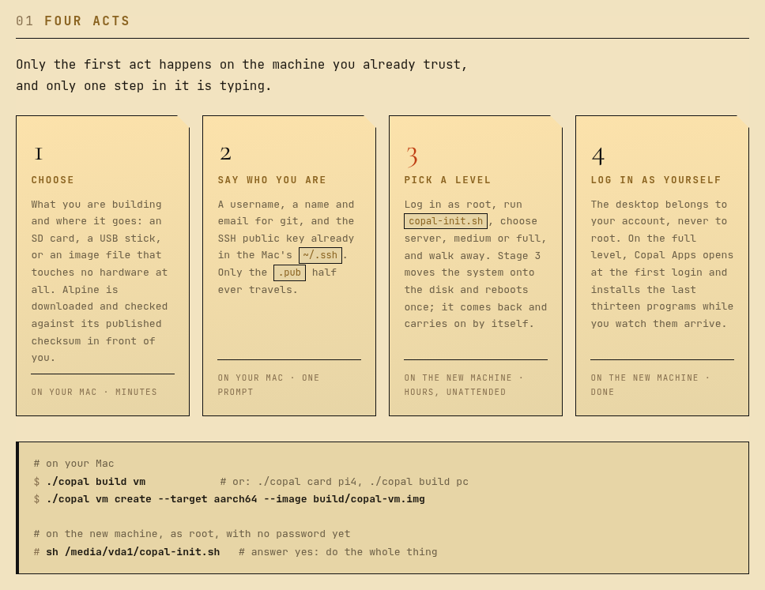

*The four acts, as the project's own site (`docs/install.html`) lays them out. Live, from the site.*

1. **Choose** — the target and the medium: an SD card, a USB stick, or an image file that touches no hardware. Alpine is downloaded and checked against its published checksum.
2. **Say who you are** — a username, a git name and email, and the SSH public key already in `~/.ssh`. Only the `.pub` half travels.
3. **Pick a level** — on the new machine, as root: run `copal-init.sh`, choose server, medium or full, and walk away. Stage 3 reboots once and the install carries on by itself.
4. **Log in as yourself** — the desktop belongs to your account, never to root.

The split between the two machines falls where it does because macOS cannot create an ext4 filesystem.

## 2. The front door: the whole process on one screen

**Why it exists.** `copal-prep.sh`'s first question used to be "what is this card for?", asked with no context. Someone arriving needs to know what they are about to start, what it costs in time and hardware, and where it ends, before a script starts erasing a disk. So `./copal` opens with a flow chart, and writes nothing.

**How it fits.** `./copal` with no verb is the menu; with a verb (`copal build pi4`, `copal card zero2`, `copal vm start`, `copal fleet ls`) it is the whole toolchain, and the make targets and `bin/` shortcuts are aliases that call it.

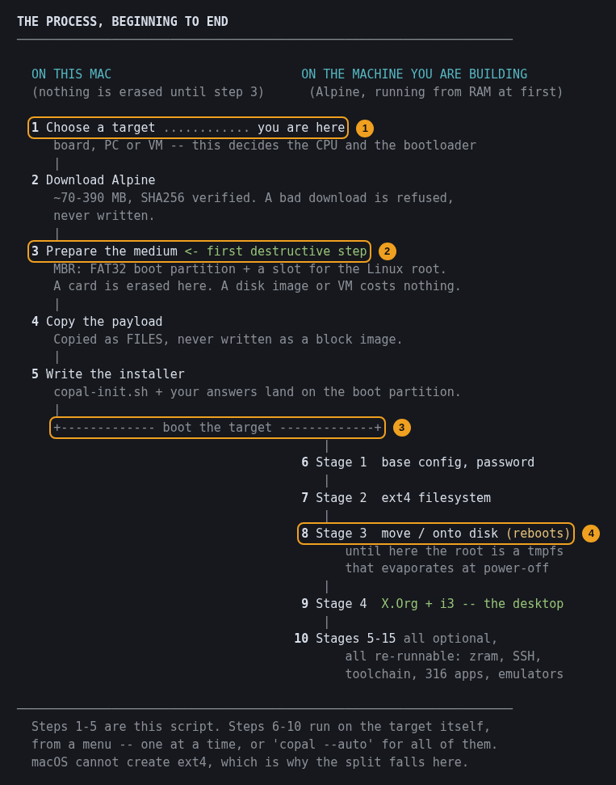

*`./copal --flow`. Live.*

1. Step 1 is where you are: the target decides the CPU and the bootloader.
2. Step 3 is the first destructive step, and it is labelled as such. A disk image or a VM costs nothing here.
3. The line where the work crosses to the machine being built. The left column is always the host, the right column always the target.
4. Stage 3 moves `/` onto the disk and reboots; until then the root is a tmpfs.

The screen says "316 apps"; the README's stage menu says 329. The counts come from different places in the repository and the guide does not choose between them.

**Check yourself**

- Which steps run on the host, and which on the target?
- Which is the first step that can destroy anything?
- Why does the split fall after step 5?

## 3. Choosing a target

**Why it exists.** The architecture is not a preference: the wrong one is not a slower system but a machine that stops dead at boot. So the menu groups the nine targets by what loads the kernel, and the right-hand column says what each is *for* rather than giving a part number.

**How it fits.** A target is the pair *(medium, what loads the kernel)*. On a Pi the GPU firmware reads the kernel off a FAT partition, so writing a card is a file copy; everywhere else GRUB on an EFI partition does it. The two UTM targets exist so the other paths can be verified without a card, a Pi or a reboot cycle.

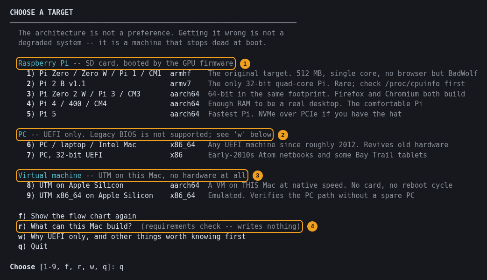

*`./copal`, after Enter. Live.*

1. Raspberry Pi targets: an SD card, booted by the GPU firmware. Five boards, three architectures (armhf, armv7, aarch64).
2. PC targets: x86_64 and 32-bit x86, UEFI or legacy BIOS from one stick (stage 3's install to the PC's own disk is UEFI only for now); `w` explains.
3. Virtual machines under UTM on an Apple Silicon Mac. Target 8 is the README's advice for newcomers: the same aarch64 payload, GRUB and `copal-init.sh` that a Pi Zero 2 W boots.
4. `r` is the requirements check (`./copal --check`): what this host can build. It writes nothing.

**Check yourself**

- Which target runs the identical code path a Pi Zero 2 W boots, with no hardware?
- Why is target 9 slow on Apple Silicon? (It is emulated by QEMU's TCG rather than virtualised.)

## 4. The briefing, before anything starts

**Why it exists.** Choosing a number does not start anything. It prints the equipment, the CPU, the minimum requirements, the expected use and the time first, so the decision is made with the costs on the screen.

**How it fits.** The offer to begin names the exact command it will hand over to, so answering `n` and typing that command yourself is a supported way to use the menu. The Makefile and any scripted caller skip the front door the same way.

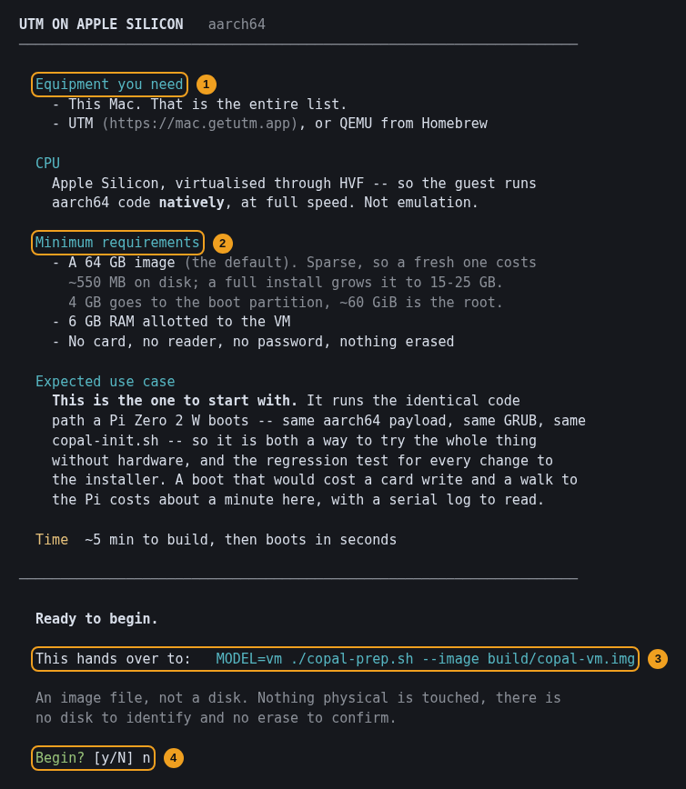

*`./copal`, then `8`, answered `n`. Live.*

1. What you need: for target 8, this Mac and UTM (or QEMU).
2. Minimum requirements. The briefing still says a 64 GB image is the default; the README's [Sizing](../README.md#sizing) section says the default is now 128g, raised after a working machine filled its root.
3. The hand-over, in full: `MODEL=vm ./copal-prep.sh --image build/copal-vm.img`.
4. `Begin? [y/N]`, answered `n` here. Nothing was written.

## 5. Writing the medium: `copal-prep.sh`

*No picture: this step downloads Alpine and partitions a disk or writes an image, and was not run for this guide.*

**Why it exists.** It is the whole distribution. It partitions the medium, fetches and SHA256-verifies the Alpine payload (a bad download is refused, never written), lays down firmware and the bootloader, and writes `copal-init.sh` and your answers onto the boot partition. The payload is copied as files, never executed, so any Mac or Linux host can build any target.

**How it fits.** It asks six questions, and only the last two can destroy anything:

| # | Question | What the answer becomes |
| --- | --- | --- |
| 1 | What is this card for? | the architecture and the bootloader |
| 2 | Username `[user]` | the account, the `doas` rule, `/home/<name>`, the account the SSH key is authorised for |
| 3 | Offer this git identity? | what stage 1 proposes on the target |
| 4 | Disk identifier, or `image` | the medium. `image` writes a sparse file and touches nothing physical |
| 5 | Type the disk identifier to confirm | proves you read *which* disk |
| 6 | Type `ERASE` to proceed | proves intent |

Answering `image` at question 4 is the whole emulation path: the same code, payload and `copal-init.sh`, with only the destination of the bytes changed. The images are raw MBR disks, so `dd` writes one straight to a card. `copal-prep.sh` does not create a UTM machine itself; `make utm` (or `utm/utm-vm.sh create`) is that step, by name.

## 6. First boot: root, with no password yet

**Why it exists.** Alpine boots from RAM with nothing configured, and setting a root password is part of what is about to run. So the first login is `root` with an empty password, and the next command is the installer on the boot partition.

**How it fits.** Root installs the system and your own account runs the desktop; Copal keeps those two jobs apart. You log in as root before stage 3 and again after its reboot. On a UTM machine the serial console (Displays → Serial 1) is the reliable one: a plain UART with its driver built into the kernel.

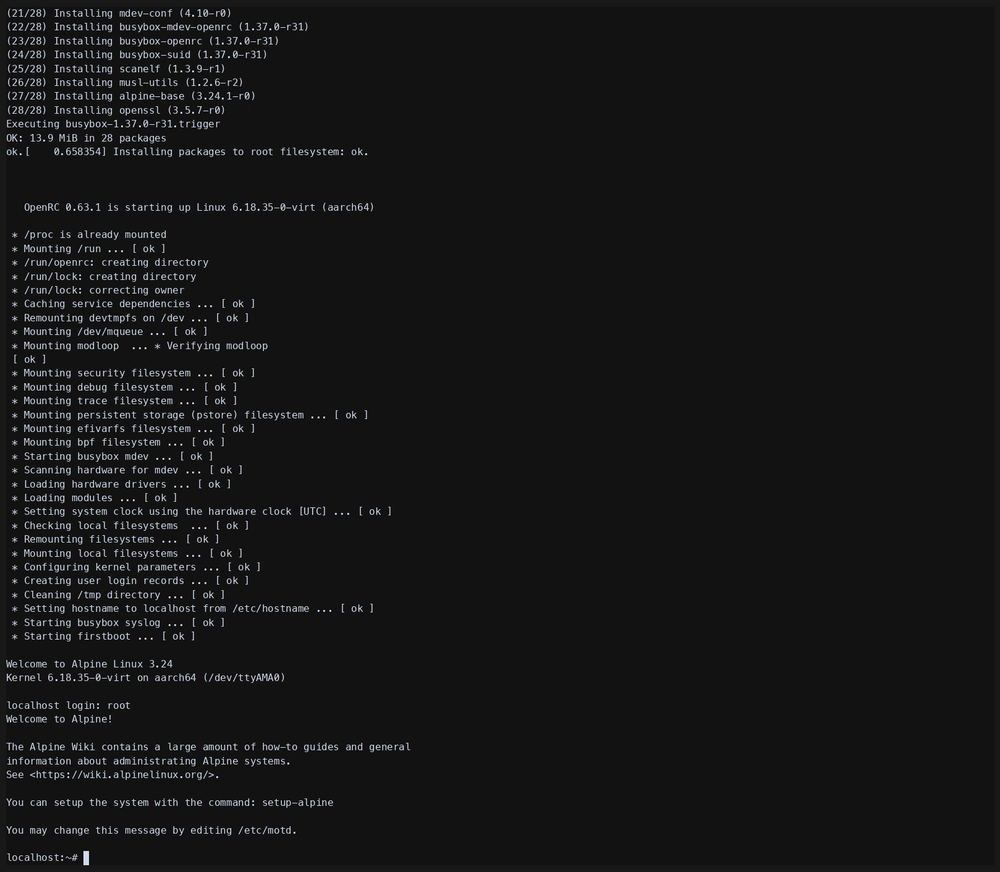

*An aarch64 VM's first boot: OpenRC comes up, `localhost login: root`, and the Alpine prompt. From the repo: a frame of `docs/media/guided-levels.gif`.*

1. `Starting firstboot ... [ ok ]` — the RAM-resident Alpine has come up from the boot partition.
2. `localhost login: root`, with no password.
3. The next step is `sh /media/vda1/copal-init.sh` in a VM (`/media/mmcblk0p1/` on a Pi); after stage 3 it is just `copal`.

## 7. Full automatic: answer once, walk away

**Why it exists.** A full install takes hours. Questions scattered through those hours mean someone has to sit and watch, so the automatic install asks everything it cannot answer itself in the first minutes, and then needs nobody.

**How it fits.** On an image nobody has set up, `copal-init.sh` first asks whether Copal should do the whole thing; `copal --auto` is the same thing later. The run order comes from a manifest inside the installer, so the order and the progress checklist cannot disagree. A marker file on the boot partition lets it survive the stage 3 reboot and resume by itself; it reboots once more at the end, with ten seconds to refuse.

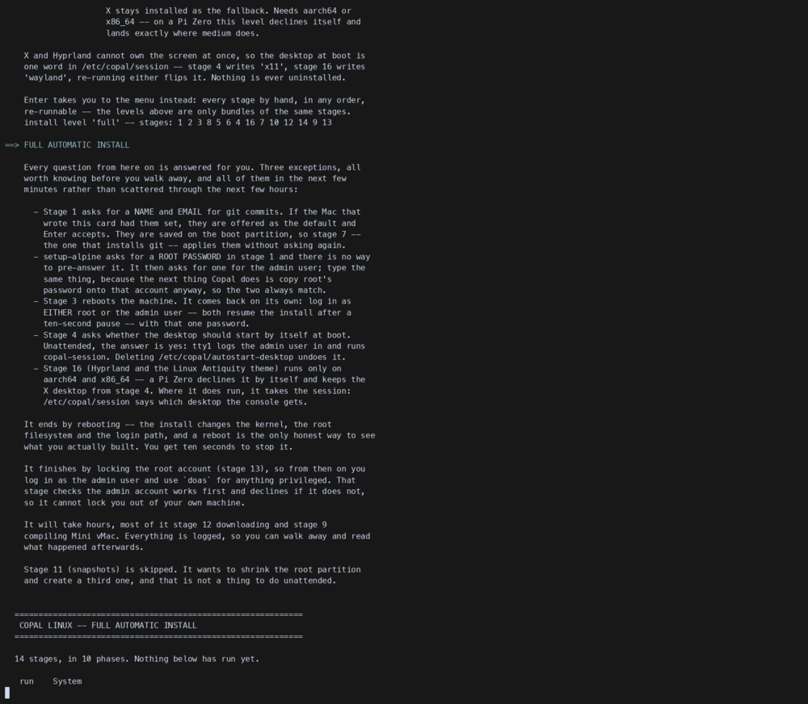

*The screen before an automatic install begins. From the repo: a frame of `docs/media/guided-levels.gif`.*

1. The three exceptions to "every question is answered for you", stated before you walk away: the git name and email, the root password (which `setup-alpine` has no answer-file variable for), and the same password for your own account.
2. The reboot at stage 3, and the install resuming on its own.
3. The end: a reboot, then root locked by stage 13, which checks that your account works first and declines if it does not.
4. Stage 11 (snapshots) is skipped, because repartitioning the disk you run from is not a thing to do unattended.

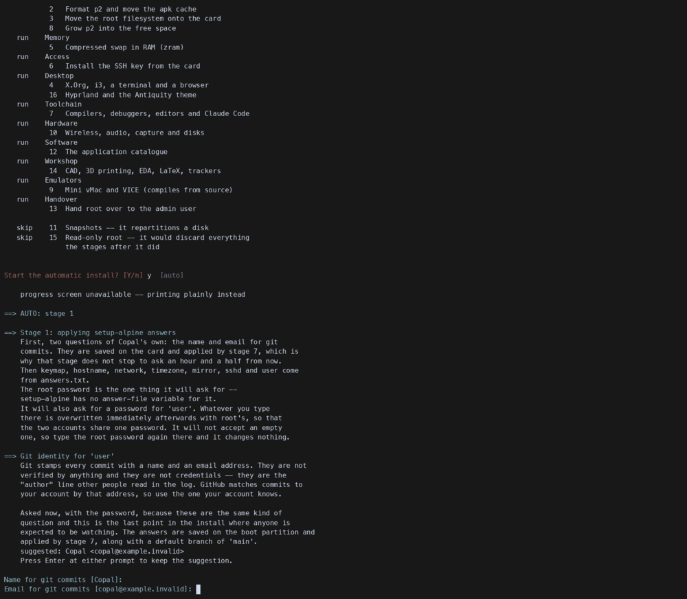

*The plan, grouped by what each phase is for, then stage 1 asking for the git identity. From the repo: a frame of `docs/media/guided-levels.gif`.*

1. `run` and `skip` for each phase: System, Memory, Access, Desktop, Toolchain, Hardware, Software, Workshop, Emulators, Handover.
2. `skip 11` and `skip 15`: snapshots repartition a disk, and a read-only root would discard what the stages after it did.
3. Stage 1 explaining why it asks for the git identity now: it is the last point anyone is expected to be watching.

**This recording is older than the current stage list.** It shows Hyprland and the Antiquity theme as stage 16; today they are stage 17, the fleet is 16, and Copal Apps is 18 (next picture). `make answers` can settle everything but the password in advance.

**Check yourself**

- Which one thing can a full automatic install never fill in for you?
- What makes it resume after the stage 3 reboot? (`rm /media/vda1/copal-auto` stops it.)
- Why is stage 11 left out?

## 8. Eighteen stages, run in any order

**Why it exists.** One machine wants a desktop, another a headless box, another the smallest thing that persists. The stages are the units those are built from: roughly, 1–3 make it a computer, 4–6 make it usable, 7–15 make it yours, 16 makes it one of several, 17 gives it the Antiquity desktop, and 18 opens Copal Apps.

**How it fits.** The levels (server, medium, full) are only lists of these same stages; nothing is a different code path. Every stage is optional, re-runnable, and may run in any order its prerequisites allow; only stage 3 is a point of no return, and it says so first. On the stage menu, *Suggested next* works out the next step from the state report it just printed, so following it is a complete strategy.

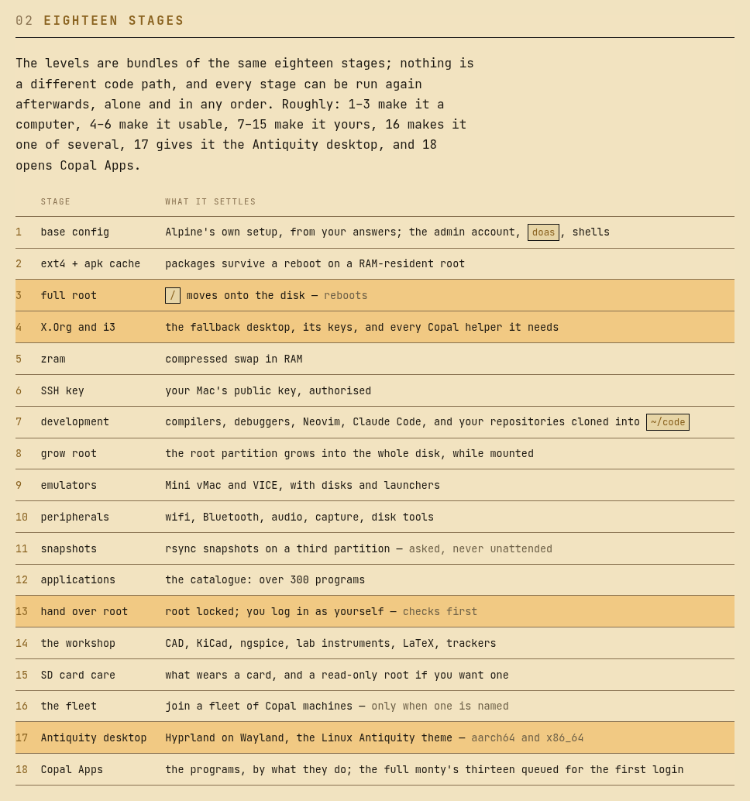

*The eighteen stages, as `docs/install.html` lists them. Live, from the site; four rows shaded.*

1. **Stage 3** moves `/` onto the disk and reboots: the end of the diskless model.
2. **Stage 4**, X.Org and i3, is the fork in the road. It runs on everything, including a Pi Zero, because it draws on the CPU into the framebuffer. Skipping it is a supported choice: the headless recipe never runs it.
3. **Stage 13** hands over root: it locks the root account and moves administration to your account through `doas`, after checking you can get in. Run it last.
4. **Stage 17**, the Antiquity desktop: Hyprland on Wayland with diinki's Linux Antiquity theme, `aarch64` and `x86_64` only.

The README's four recipes are lists of these: **A** everything, unattended; **B** a desktop by hand (`1 2 3 · reboot · 4 5`); **C** headless with a real root (`1 2 3 · reboot · 5 6 7 13`); **D** the smallest thing that persists (`1 2 5 6`, no stage 3, and `lbu commit -d` to keep changes).

**Check yourself**

- Which recipe keeps the root in RAM, and what do you have to run to keep a change?
- Why is zram (stage 5) in the minimum desktop rather than the extras?
- What does stage 13 check before it locks root?

## 9. The desktop, as your own account

**Why it exists.** Starting X as an ordinary user on a framebuffer with no seat manager usually fails with a black screen, because three separate things must be true (group membership, `allowed_users=console`, `needs_root_rights=yes`). Stage 4 sets all three, and asks whether the desktop should start by itself at boot. Copal ships two desktops on purpose: i3 on X.Org for everything, and Hyprland on Wayland where the hardware can carry it.

**How it fits.** The desktop is where the stages' helpers live: `copal-menu` and `copal-center` show what you *could* install but have not, because software you do not have is not discoverable from `PATH`; `copal-config` handles users, hostname, services and boot options; `Super`+`/` shows the key list. The serial console keeps its ordinary login either way, so autostart never costs a way in.

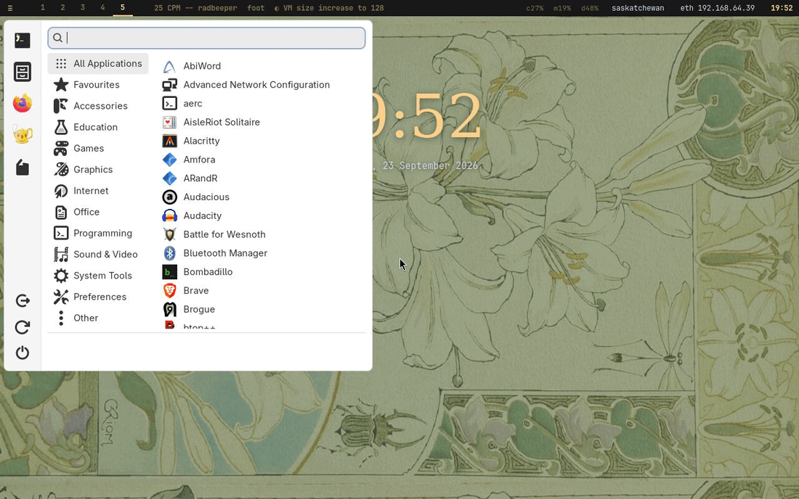

*The full level's desktop: Hyprland with the Linux Antiquity theme and the application menu open. From the repo: `docs/img/site/desktop-menu.jpg`, the site's picture of a real install (reduced to 256 colours to keep the file small).*

1. The bar across the top is **waybar**, standing in for the theme's quickshell bar, which no Alpine repository packages: workspaces, the focused window, load, network and the clock.
2. The application menu, grouped by category, with the session buttons down its left edge. The site captions it `Super`+`A` on this desktop.
3. The large clock is a desktop widget on the bottom layer, under the windows (`copal-widgets --off` hides it).

There is no picture of the i3 desktop in the repository to reuse, and this script cannot start one.

**Two things that are easy to miss.** In a UTM window the Mac takes `Cmd` first, so **Caps Lock is a second Super**. And copy and paste use the same keys everywhere (`Super`+`C`, `Super`+`V`; `Super`+`Ctrl`+`V` for the history): `copal-clip` asks what has focus and sends the chord that window wants, an idea taken from Omarchy.

## 10. Copal Apps: the store

**Why it exists.** Many programs people want are not packaged by Alpine. Stage 18's **Copal Apps** lists programs by what they do, two sentences each on what it is, where it comes from, what it needs and the steps its playbook takes, and compiles the missing ones on the machine from their GitHub source, pinned by checksum. The rest come from Alpine; nothing comes from Flathub.

**How it fits.** Every project Copal installs is a **playbook** under `playbooks/`; `make sync-playbooks` assembles them into the one installer file, and the store carries its share. Install and Remove run `doas copal-store`, and removing a build takes away every file it installed.

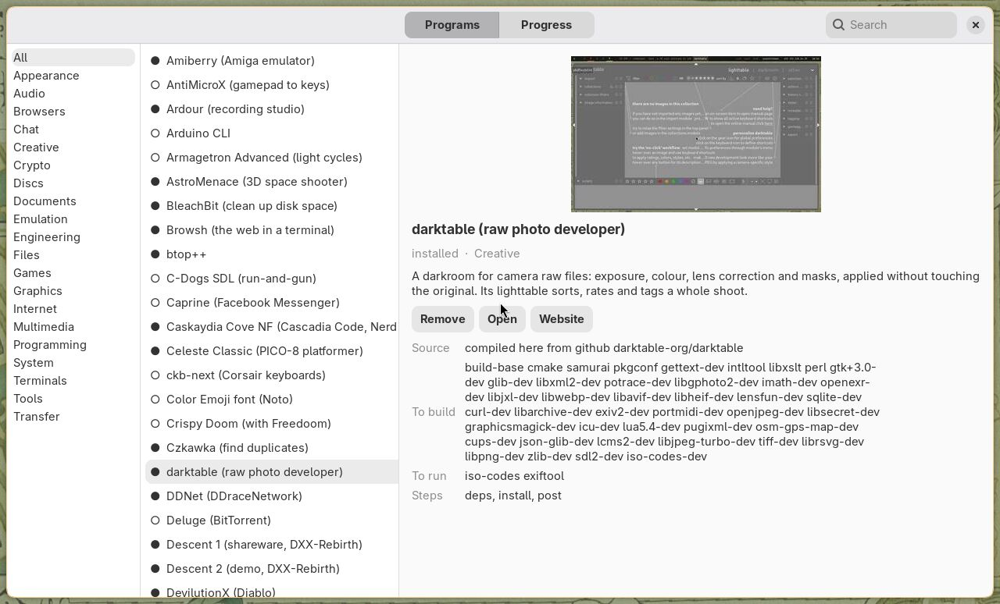

*Copal Apps, with darktable selected. From the repo: `docs/img/site/copal-apps.jpg`.*

1. Sections down the left, by what a program does.
2. The selected program: a picture, its two sentences, and Remove, Open and Website.
3. Where it comes from (here, compiled from `github darktable-org/darktable`), what it needs to build and to run, and the playbook's steps.

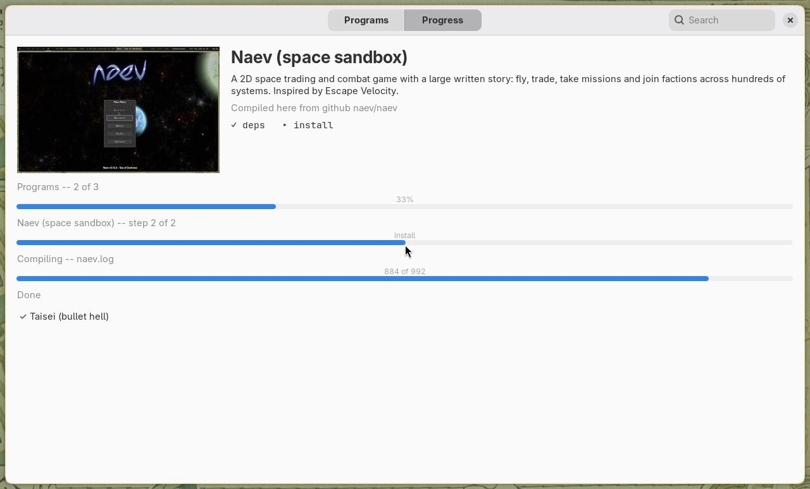

*Installing: the window turns into a slideshow of the programs arriving. From the repo: `docs/img/site/copal-apps-progress.jpg`.*

1. One bar for the run (programs 2 of 3), one for the program and its step, one for the compile.
2. What has already arrived, under *Done*. At the full level, stage 18 queues the full monty's programs for the first desktop login, so this is what that login opens on.

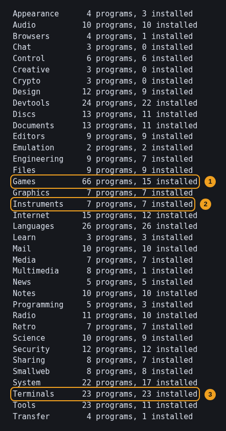

*`copal-store sections` on the machine that took these pictures: each section, how many programs it offers, and how many are installed here. Live.*

1. Games: many offered, few installed. The store's own shelf installs nothing until you pick from it.
2. Instruments and 3. Terminals: every program in the section installed on this machine.

`docs/copal-store.md` records every Pi-Apps entry and where it went, including the ones not ported and why.

## 11. The guides on the machine

**Why it exists.** A tiling desktop with no start menu is unusable until you know the bindings, and the reasons behind a machine's setup are no use if they live only in a README on another computer. So the machine carries its own plain-text guides.

**How it fits.** `copal-guide` lists them; `copal-guide code` (for example) opens one; `Super`+`Shift`+`G` opens them from the desktop. They are written by the stages, so a guide arrives with the thing it explains.

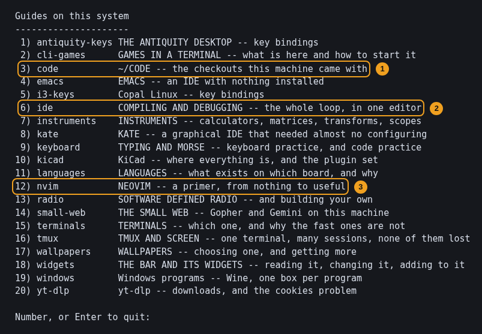

*`copal-guide`. Live.*

1. `code`: the checkouts in `~/code` this machine came with. Stage 7 clones the repositories you named and builds them with `copal-build`; `~/code/copal` is always there.
2. `ide`: compiling and debugging, the whole loop, in one editor.
3. `nvim`: a primer. The editor is Neovim set up as an IDE with no plugins, using LazyVim's keys (leader is `Space`) on top of Neovim's built-in LSP and completion.

## 12. Updating, and the edit-and-see-it loop

**Why it exists.** A package manager is another network service to be down, another key to expire and another index to be stale, on a board whose most common problem is *no network yet*. Copal is one shell script instead: every stage, guide and helper lives inside `copal-init.sh`, so updating is fetching one file.

**How it fits.** Updating changes what the stages *will* do and re-runs nothing; you re-run the stages you care about. On a machine with `/etc/copal/allowed_signers`, only a signed `copal-prep.sh` is installed.

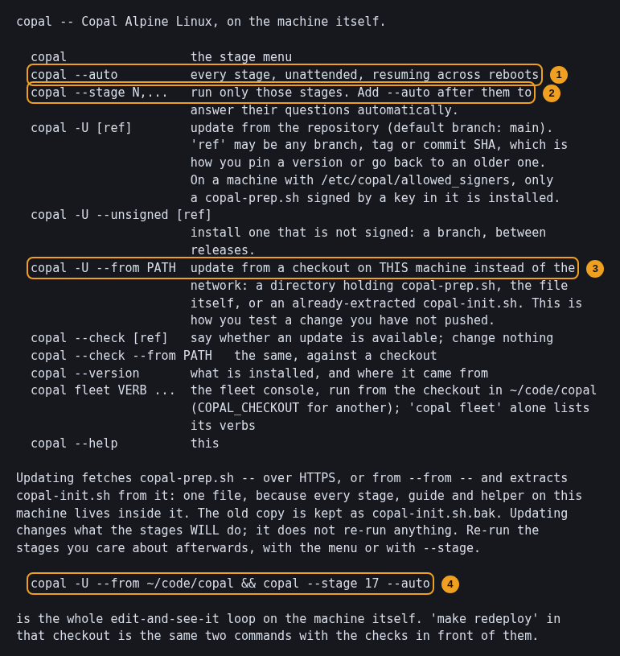

*`copal --help`, on a Copal machine. Live.*

1. `copal --auto`: every stage, unattended, resuming across reboots.
2. `copal --stage N,...`: only those stages; add `--auto` to answer their questions.
3. `copal -U --from PATH`: update from a checkout on this machine rather than the network, which is how a change is tested before it is pushed.
4. The whole loop, in one line: `copal -U --from ~/code/copal && copal --stage 17 --auto`. `make redeploy` in the checkout is the same, with `make lint` in front.

**Check yourself**

- After `copal -U`, has anything on the machine changed yet?
- Why does `make lint` extract `copal-init.sh` and run `sh -n` on it? (A syntax error inside a heredoc is invisible to every check that reads the generator.)

## 13. The fleet: many machines as one

**Why it exists.** Several Copal machines on one LAN — the README's example is a museum's — should be run as one: switched on, given the day's task and put to sleep together, without touching each machine.

**How it fits.** Stage 16 is the target's half (a beacon, this node's facts, its half of enrolment) and runs only on a card that named a fleet. `copal fleet` is the console's half, on the host or a node. A scene (`wake`, `show`, `reset`, `rest`, `sleep`) is an Ansible playbook in `fleets/<name>/`, committed to git, because the fleet executes what the repository says and not what the network says.

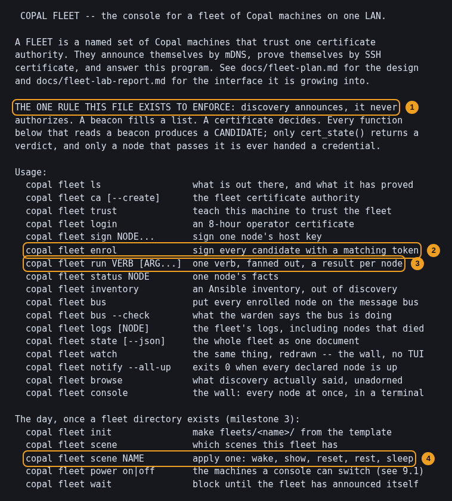

*`./copal fleet`, with no verb. Live.*

1. The one rule: discovery announces, it never authorizes. mDNS has no authentication, so a beacon only fills a candidate list; an SSH certificate decides.
2. `enrol` checks each candidate's single-use token against the ledger written when its card was made, then signs its host key.
3. `run` fans one verb out over every enrolled node and prints a result each.
4. `scene NAME` applies one day's state to the whole fleet; applying it twice does nothing the second time.

The README is plain that the bus and the wall are the next milestone (`docs/fleet-m4-backlog.md`), and that a Raspberry Pi cannot be woken by Wake-on-LAN: `wake` supports switched power, and defaults to always-on.

## 14. How it fits together

| Part | Runs on | Why it exists | Fits with |
| --- | --- | --- | --- |
| `./copal` front door | host | shows the process, the targets and the costs before anything is erased; writes nothing | hands over to `copal-prep.sh` by naming the command |
| `copal-prep.sh` | host | the whole distribution: verify Alpine, prepare the medium, write `copal-init.sh` and your answers | its output is a card, a stick or an image; `make utm` / `copal-vm.sh` boot an image |
| `copal-vm.sh`, `utm/utm-vm.sh` | host | the same code path on a VM, so a change is tested in a minute instead of a card write | `copal-vm.sh --check` is the regression test |
| `copal-init.sh` (one file) | target, as root | eighteen re-runnable stages; the only thing that crosses from host to target | levels and recipes are lists of its stages |
| Full automatic | target | every question in the first minutes, then hours unattended | resume marker across the stage 3 reboot; stage 13 last |
| Stages 1–3 | target | a real root filesystem out of a diskless Alpine | everything else needs them (except recipe D) |
| Stage 4 / stage 17 | target | a desktop for every board (i3), and Hyprland where the GPU allows | `copal-menu`, `copal-center`, `copal-config`, the unified clipboard |
| Playbooks | repo | one file to ship, many files to write and review | `make sync-playbooks` assembles them; `make lint` catches drift |
| Copal Apps (stage 18) | target | programs Alpine lacks, compiled from source and pinned | the store's playbooks; `doas copal-store` |
| `copal-guide` | target | the reasons and the keys, on the machine itself | written by the stages that install what they explain |
| `copal -U`, `--stage` | target | update by fetching one file; re-run only what changed | `make redeploy` from `~/code/copal` |
| `copal fleet`, stage 16 | host or node | many machines run as one, with certificates, not beacons, deciding | scenes in `fleets/<name>/`, applied by Ansible |

The asymmetry is the design: the host has the network, the disk and the tooling and does everything that needs them; the target has as little as 512 MB and an SD card and does nothing it does not have to. Nothing travels between them but one shell script, which is why updating is a single fetch and why what the machine will do is a file you can read.
