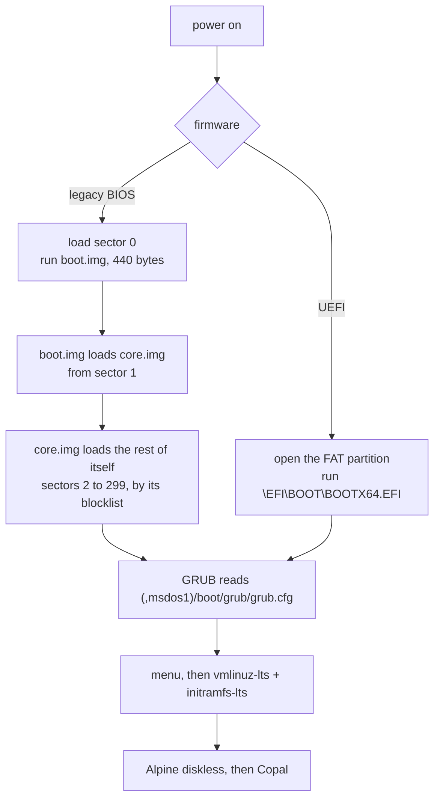

# Legacy BIOS from a Mac, a Hostname That Never Changed, and a First Login That Says What to Do

*Lab Report — IEEE Format · 27 October 2026*

<!-- SPDX-License-Identifier: MIT -->
Copyright (c) 2026 Paul Richeson. MIT licensed — see `LICENSE`. Copal Linux is
an aggregation of Alpine Linux, not a derivative work of it; Alpine and its
packages remain under their own licences. The two GRUB files in
`vendor/grub-i386-pc/` are GRUB's, under the GNU GPL version 3 or later (see
`vendor/grub-i386-pc/SOURCE`).

---

## Abstract

Three changes to how a Copal card is written, each with its cause:

1. **The hostname.** Four machines in a row were called `saskatchewan`. The
   random picker was uniform and correct; it never ran. `make answers` saved
   the first river it offered into `answers.txt`, every later run offered the
   saved name back, and the name was fixed on the card at write time, so one
   card named every machine installed from it alike. The hostname is now
   `random` unless a name is typed: stage 1 draws a river from `waters.txt` on
   the card, on the machine, with `/dev/urandom`.
2. **Legacy BIOS.** Copal was UEFI-only, for a stated reason: a BIOS boot needs
   boot code written into sector 0 and the sectors before partition 1, and the
   tools that write it are Linux tools, while cards are written on a Mac. But
   for an MBR disk whose partition 1 starts at sector 2048, what `grub-install`
   writes is the same bytes on every card. They are now built once on Alpine
   (`tools/grub-bios-build.sh`), kept in `vendor/grub-i386-pc/`, and written by
   `dd` (`copal-disk.sh biosboot`). One PC card now boots both ways.
3. **The first login.** A fresh card booted to Alpine's stock "Welcome to
   Alpine!". It now carries a starter overlay, `copal-first.apkovl.tar.gz`,
   whose `/etc/issue` says to log in as root and whose login message says to
   look at `answers.txt` and run `copal-init.sh`; after stage 1 the same
   message says how to carry on, at every login until the install is done.

Tested in QEMU on the Mac: SeaBIOS (a legacy BIOS) boots a freshly written
card as a USB stick through the new boot code to Copal's login prompt, with
the new message. The results are in section IV.

## I. Objective

1. Find why the random hostname kept coming out the same, and make it change
   on every install.
2. Boot a Copal USB stick on a PC set to legacy (CSM, MBR) boot, written on the
   Mac as before, with no Linux tool on the Mac.
3. Make the first login, and every login until the install finishes, say what
   to do next.

## II. Materials

| Item | Detail |
| --- | --- |
| Writing machine | Apple M1 Mac, macOS (Darwin 25.6), the repository at `164ebd5` plus this work |
| Alpine machine | `saskatchewan`, a Copal (Alpine 3.24.3) x86_64 PC, used as an ordinary user, nothing installed |
| GRUB | Alpine `grub` and `grub-bios` 2.14-r0, fetched with `apk fetch`, run from the unpacked package |
| Emulator | QEMU (Homebrew) `qemu-system-x86_64`: `-machine pc` with its default SeaBIOS for legacy; `-machine q35` with `edk2-x86_64-code.fd` for UEFI |
| Test images | `build/copal-pc.img` from 10 September (a copy); a fresh `./copal build pc --auto` image |
| Alpine initramfs source | `/usr/share/mkinitfs/initramfs-init` on saskatchewan, read for the overlay rules |

## III. Techniques

### A. Finding why the hostname never changed

The pool and the picker were read first (`copal-prep.sh`, `hostname_pool` and
`random_hostname`): 298 names, `$RANDOM` with the short tail rejected, so the
pick is uniform. That ruled out the picker and pointed at its callers:

- `copal-prep.sh` takes `CFG_HOSTNAME` from `COPAL_HOSTNAME` in `answers.txt`
  before falling back to `random_hostname`, and `answers.txt` held
  `COPAL_HOSTNAME='saskatchewan'`.
- `tools/copal-answers.sh` offered `${COPAL_HOSTNAME:-$(random_hostname)}`,
  and its own note said why the name stuck: "Once answers.txt exists its own
  hostname is the default, not a new one."
- The name went onto the card as `HOSTNAMEOPTS="-n saskatchewan"` in the
  card's `answers.txt`, which setup-alpine reads on the machine. So even a new
  draw per card would give every machine installed from one card the same
  name.

**The fix moves the draw to where the install happens.**

| Where | Before | After |
| --- | --- | --- |
| `make answers` | offers a drawn river, saves it | offers `random`, saves `random` unless a name is typed |
| `copal-prep.sh` | writes the name into the card's `answers.txt` | for `random` (or unset) writes `COPAL_RANDOM_WATER` there, and the 298 names to `waters.txt` |
| stage 1, on the machine | setup-alpine reads the card's file | `setup_answers` draws a river, writes a copy in `/tmp` with it filled in, and setup-alpine reads the copy; the card keeps saying `random` |
| a machine set up before | — | keeps its own hostname when stage 1 is re-run |
| a fleet card | `fleet-NN` | unchanged |

The draw (`draw_water`): 16 bits from `/dev/urandom` with `od`, the tail that
would favour the front of the list drawn again, the line picked with `sed`.
No pool on the card (an older card) gives `copal-XXXX`. Busybox has every
tool it uses.

**Tested** in a shell harness on the Mac with the real pool: four runs of
`setup_answers` gave `zapata`, `winnebago`, `columbia`, `xingu`; 600 draws
covered 254 of the 298 names (chance predicts about 258); an empty pool and a
missing pool both gave `copal-XXXX`; the card's `answers.txt` still read
`COPAL_RANDOM_WATER` afterwards. The harness also caught a bug before it
shipped: `grep -c . file || echo 0` prints `0` twice on an empty file, since
`grep -c` prints the count *and* fails.

Paul's own `answers.txt` was changed to `COPAL_HOSTNAME='random'` (it is
gitignored).

### B. Legacy BIOS boot, written from a Mac

**1. What a BIOS needs.** A BIOS loads sector 0 and runs its first 440 bytes.
GRUB's `boot.img` fits there; it loads `core.img` from the sectors between the
partition table and partition 1 (the "MBR gap"), and `core.img` reads
`grub.cfg` from a filesystem. On an MBR disk, `grub-install` does exactly two
writes: `boot.img` into sector 0 (keeping the partition table), and `core.img`
from sector 1 onward.

**2. Why those bytes are the same on every card.** Both layouts Copal writes,
`diskutil partitionDisk ... MBRFormat` on the Mac (read with `fdisk` from two
images it wrote) and the `sfdisk` script on Linux (which aligns to 1 MiB by
default), put partition 1 at sector 2048, leaving 2047 free sectors.
`biosboot` checks this on every card rather than trusting it. The bytes were then read out of the files:

| Field | Where | Value as built | What it means |
| --- | --- | --- | --- |
| kernel sector | `boot.img` 0x5C, 8 bytes | 1 | load `core.img` from sector 1 |
| boot drive | `boot.img` 0x64 | 0xFF | use the drive the BIOS booted from |
| drive check | `boot.img` 0x66, 2 bytes | `EB 05` (a jump) | `grub-bios-setup` writes `90 90` here for a hard disk |
| blocklist | `core.img` bytes 500 to 511 | start 2, length 298, segment 0x0820 | the rest of `core.img` is sectors 2 to 299 |

`grub-mkimage` already ends the first sector of `core.img` with the blocklist
for "embedded at sector 1". So the only patch `grub-bios-setup` would make is
the drive-check NOP, which lets a BIOS that passes a wrong drive number (some
do, for USB) still boot. The prefix is built in as `(,msdos1)/boot/grub`:
partition 1 of whichever disk the BIOS booted, with no UUID and no label, so
one `core.img` serves every card.

**3. Building them without installing anything.** On saskatchewan, as an
ordinary user: `apk fetch grub grub-bios` downloads the packages without
installing them, `tar -xzf` unpacks each `.apk` (gzipped tar segments; the
signature segment's complaint is harmless), and `grub-mkimage` runs from the
unpacked tree (`ldd` showed its libraries already present). Every module
`grub.cfg` needs is built into `core.img` (`biosdisk part_msdos fat normal
linux echo test search search_label search_fs_uuid configfile ls minicmd cat
halt reboot`, 152,900 bytes, 299 sectors), because the card carries no
`i386-pc/` module directory. `tools/grub-bios-build.sh` does all of this and
checks the two facts above, so a GRUB that ever changes them fails at build
time instead of at a black screen.

**Not taken:** `grub-bios-setup` on a disk image file. GRUB 2.14 guesses the
root device from the directory holding `core.img`, found the Alpine
machine's own NVMe partition, and failed; 2.14 has no option to name it. A
loop device would work but needs root on the census machine. Reading the
format and writing the bytes was smaller, and every byte is checked.

**4. Writing them: `copal-disk.sh biosboot DISK DIR`.** A new verb in the disk
layer, with both backends, so the self-test's totality check covers it (61
checks pass). It is host-independent; each backend only names the raw device
(`/dev/rdiskN` on macOS, `/dev/sdX` on Linux). In order, it:

1. reads sector 0 and refuses a disk with no `0x55AA` signature;
2. reads partition 1's start (offset 454) and refuses if it is not past
   `core.img` (an old 63-sector layout);
3. builds the new sector 0: `boot.img`'s first 440 bytes, then the disk's own
   bytes 440 to 511 (disk signature and partition table), the drive-check NOP,
   and partition 1 marked active (0x80 at 446, the other three cleared);
4. writes `core.img`, padded to whole sectors (a raw device refuses part of
   one), from sector 1, then the new sector 0.

The active flag is set here, not by the existing `bootflag` verb, because
`bootflag`'s macOS form is `fdisk -e` behind sudo, which rewrites sector 0
itself; and the write is placed after the build's boot-flag step for the same
reason. Some BIOSes will not offer a USB stick with no active partition;
UEFI ignores the flag.

Two details came from testing:

- The first write to sector 0 of a just-attached image was refused once and
  accepted at once when repeated; macOS's Disk Arbitration was still probing
  the disk. Each write is tried five times, a second apart.
- **On the first real stick, every write to sector 0 was refused.** `make
  sd-pc` printed `could not write the boot sector to /dev/rdisk4`, and `mount`
  showed both partitions back under `/Volumes` (FSKit, macOS's FAT driver
  on this Mac): Disk Arbitration mounts them again within seconds of an
  unmount, and macOS refuses a write to the partition table of a disk with a
  partition mounted. Sectors 1 onward are not refused, so `core.img` was
  written and sector 0 was not. Each try now unmounts the whole disk
  immediately before it writes, and a refusal prints `dd`'s own message.
  Tested on an image with both volumes mounted on purpose: written, p1
  active. (The QEMU image builds had not shown it: an attached image is not
  remounted the same way.)
- An image attached by the user has a device node the user can write, so
  `dd` runs without sudo when the device is writable and through `priv` when
  it is not (a real card). That keeps `./copal build --auto`, which has no
  sudo password, able to write the boot code.

**5. Testing without the target PC.** QEMU's `-machine pc` firmware is
SeaBIOS, a legacy BIOS, and `-device qemu-xhci -device usb-storage` presents
the image as a USB stick, as on the target. `-snapshot` keeps the image
unchanged. With no display (`-display none`), screens were taken through the
QEMU monitor on a Unix socket (`screendump`, a PPM, converted with `sips`),
and keys sent the same way (`sendkey`).

A control isolates what is new: the same image under UEFI (`-machine q35`
with EDK2). On the 10 September image both stopped at the same line,
`Mounting boot media: failed`, so that stop was not the BIOS path. It is
fault 4 of `pc-install-lab-report.md` (the netboot initramfs has no
`sd_mod`), fixed after that image was built; a fresh image was built for the
real test (section IV).

### C. The first login's message

**1. Where the message can live.** A fresh card has no saved configuration
(apkovl), so the machine boots a stock Alpine root and nothing Copal writes
into `/etc` exists yet. Alpine's initramfs unpacks an apkovl from the boot
medium over `/` at boot, so the message travels as one:
`copal-first.apkovl.tar.gz`, written by `copal-prep.sh`, owned by root
(`tar --uid 0 --gid 0`), with no macOS metadata (`COPYFILE_DISABLE=1`).

| File | Shown | Says |
| --- | --- | --- |
| `etc/issue` | before the login prompt | not set up yet; log in as root, no password until setup |
| `etc/motd` | after login | a one-line Copal banner |
| `etc/profile.d/copal-setup.sh` | after login, every login | before stage 1: look at `answers.txt` (`less /media/usb/answers.txt`), then `sh /media/usb/copal-init.sh`; after stage 1: how to carry on (`doas` for the user); silent while the auto-resume block in `.profile` is doing the same job |
| `etc/.default_boot_services` | — | empty; see below |

The path is not written in: the script finds the medium (`/boot` after stage
3, `/media/*` before) by the `copal-init.sh` on it, so the same message is
right on a stick (`/media/usb`), an SD card and an installed disk.

**2. Two rules from Alpine's initramfs source**, read on saskatchewan
(`/usr/share/mkinitfs/initramfs-init`, mkinitfs 3.24):

- Line 972: the default boot services (devfs, dmesg, mdev, hwdrivers,
  modloop, networking and the rest) are added only if there is no overlay
  *or* the overlay contains `etc/.default_boot_services`. An overlay without
  it boots a machine with no device manager and no network. The starter
  carries the empty file; the initramfs deletes it after use.
- Line 941: with more than one overlay on the medium it loads only the first
  it finds (`head -n 1`). So stage 1 deletes the starter before its `lbu
  commit`, or the next boot could load the starter and pass over the saved
  configuration. What the starter put in `/etc` is part of the running system
  by then, so the commit carries the message forward.

**3. Where it ends.** `copal-init.sh` removes `copal-setup.sh` when the menu's
next suggestion is `v` (every stage done), and `auto_finish` removes it when
an automatic install completes. `apkovl_exists` now ignores the starter, so
every check that asks "has stage 1 run?" still answers correctly.

## IV. Results

| Test | Result |
| --- | --- |
| `copal-disk.sh self-test` | 61 checks pass, 16 verbs, both backends |
| `bash -n` on `copal-prep.sh`, `copal-answers.sh`; `sh -n` on `copal-disk.sh` | pass |
| `biosboot` on a copy of the 10 September image | `core.img` read back identical; kernel sector 1, drive check `90 90`; partition table bytes unchanged |
| SeaBIOS, that image as a USB stick | GRUB ran from sector 0 and read the card's `grub.cfg`: "Booting `Copal Linux (lts -- real hardware)'"; the kernel and initramfs started; then `Mounting boot media: failed` |
| EDK2 (UEFI), the same image | the same stop at the same line: the old image's fault, not the BIOS path |
| hostname draw harness | a different river each run; 254 of 298 names in 600 draws; fallbacks work; the card's file unchanged |
| fresh `./copal build pc --auto` | built; `fdisk` shows partition 1 active (`*`) at 2048; `core.img` read back identical; `copal-first.apkovl.tar.gz` holds the four files, root-owned; `waters.txt` 298 lines; the card's `answers.txt` reads `COPAL_RANDOM_WATER` |
| SeaBIOS, the fresh image as a USB stick | **boots to the login prompt.** GRUB from sector 0, its menu, the kernel, "Mounting boot media" ok, modloop, mdev, hardware drivers and every default service started (so `.default_boot_services` worked), then the starter's `/etc/issue`: "Copal Linux on Alpine 6.18.35-0-lts (/dev/tty1) / Not set up yet. Log in as root -- there is no password until setup." |
| the message after logging in as root | the banner, then "Copal: this machine is not set up yet. ... Look at them first: `less /media/sda1/answers.txt` ... Then start the install (as root): `sh /media/sda1/copal-init.sh`". QEMU's initramfs mounted the stick as `/media/sda1`; on the PCs of `pc-install-lab-report.md` it was `/media/usb`, which is why the script finds the path rather than naming it. (A first run's monitor socket stopped answering after the key presses; the second, sending every command over one connection, worked.) |

`shellcheck` was not run: it is not installed on this Mac (`make shell-lint`
needs it).

## V. Discussion

**What "legacy" covers so far.** The stick boots under a BIOS. Installing to
the PC's internal disk on a BIOS machine does not yet: stage 3
(`prepare_root_disk`) lays out GPT with an EFI partition and puts GRUB at
`\EFI\BOOT\`, which a BIOS cannot run. The installer already detects the
firmware (`firmware_mode`). On a BIOS machine it should lay the disk out as
MBR (or add the 1 MiB `bios_grub` partition GPT needs) and run `grub-install
--target=i386-pc`, which is easy there because stage 3 runs on Linux. Until
then, a BIOS machine runs Copal from the stick, diskless, which is how the Pi
runs it.

**A DVD.** A hybrid ISO (El Torito for BIOS and UEFI, and an MBR so the same
file copied to a stick boots) is how Alpine ships its own; `xorriso` builds
one, on the Mac or on Copal. A DVD is read-only, so `lbu commit` cannot save
the configuration to it: it would be an installer or a live disc, saving to a
stick or a disk.

**The GPL.** `vendor/grub-i386-pc/` is the first GRUB code kept in the
repository; the UEFI GRUB is still taken from Alpine's ISO at build time.
`SOURCE` names the Alpine packages and their corresponding source. If the
project would rather keep no GPL binaries, the alternative is to run
`tools/grub-bios-build.sh` on a Copal machine or the VM at build time.

**Why not syslinux.** Alpine's own ISO boots BIOS through isolinux. Copal
already reads one `grub.cfg` for UEFI; a second boot loader with a second
configuration is two menus to keep in step. GRUB for both keeps one.

## VI. Verifying a written stick, and adding the boot code to one

A stick written before this change, or one whose sector-0 write was refused
(section III.B.4), needs only the boot code, not a rewrite. From the
repository, with the stick in (find its `diskN` with `diskutil list external
physical`; on 27 October it was `disk4`, "MKNUFDVP64GB", partitions
`COPALBOOT` and `COPALROOT`):

```
sh tools/copal-disk.sh biosboot disk4 vendor/grub-i386-pc
```

It asks for the sudo password unless sudo is cached, and prints nothing when
it succeeds. Then three checks, each read without changing anything. Raw
reads of a real disk need sudo (`fdisk /dev/disk4` alone answers
"Permission denied"); an image file does not.

| Check | Command | Expect | What it proves |
| --- | --- | --- | --- |
| partition 1 active, at 2048 | `sudo fdisk /dev/disk4 \| sed -n 6p` | `*1: 0B ... [      2048 - ...] Win95 FAT-32` | the `*` is set only by `biosboot` (or `bootflag`); 2048 leaves room for GRUB |
| GRUB's boot code in sector 0 | `sudo dd if=/dev/rdisk4 bs=512 count=1 2>/dev/null \| od -An -tx1 -j 92 -N 12` | `01 00 00 00 00 00 00 00 ff fa 90 90` | `01`: load the core from sector 1; `ff`: use the BIOS's drive; `90 90`: the drive-check patch |
| GRUB's core after it | `sudo dd if=/dev/rdisk4 bs=512 skip=1 count=299 2>/dev/null \| head -c 152900 \| cmp - vendor/grub-i386-pc/core.img && echo core ok` | `core ok` | sectors 1 to 299 hold exactly the built `core.img` |

A sector 0 with no GRUB code reads all zeros in the second check (a fresh
`diskutil` MBR) or other bytes (another boot loader). Then `diskutil eject
disk4` before unplugging it.

Confirmed on Paul's stick, 27 October: `biosboot` silent, then `*1: 0B ...
[      2048 -    7812504] Win95 FAT-32`.

## VII. MBR and GPT

**The boot code is for MBR disks only, and `biosboot` refuses a GPT disk by
name.** On GPT, sector 0 is only a protective MBR, one entry of type `0xEE`
covering the disk, and sectors 1 to 33 hold the GPT header and partition
table: exactly where `core.img` goes. Writing it there would destroy the
partition table. `biosboot` reads the first entry's type and stops:
"is a GPT disk; this boot code is for MBR disks only". Tested on a GPT image
made by `diskutil partitionDisk ... GPT`: refused, exit 2, nothing written.
(Before this check, the start-sector check already refused it, as "partition
1 starts at sector 1", but did not say why.)

BIOS boot from GPT is possible, and is what Linux installers do: a 1 MiB
"BIOS boot partition" (type `21686148-6E49-6F68-744E-656564454649`) holds
`core.img`, and `grub-install` writes its blocklist to point there. The
images in `vendor/grub-i386-pc/` always load from sector 2, so they cannot.

| Disk | UEFI | Legacy BIOS |
| --- | --- | --- |
| Copal card or stick (MBR, written by `copal-prep.sh`) | yes | yes, with `biosboot` |
| GPT disk | yes | no: needs a `bios_grub` partition and `grub-install` on Linux |
| a PC's own disk after stage 3 (GPT today) | yes | not yet (open item 1) |

So every card Copal writes boots both ways. When stage 3 learns to install
for a BIOS machine (section V), it will run on Linux and can use
`grub-install --target=i386-pc` directly: MBR for a BIOS-only machine, or GPT
with a `bios_grub` partition.

## VIII. The first test on the legacy PC, and stage 3 for a BIOS machine

**What happened (27 October, Paul's legacy PC, the stick from section VI).**
The stick booted under the BIOS, the hostname was drawn (`frome`, one of the
298), stage 1 ran, and the install was pointed at the PC's own disk (`sda`).
Stage 3 rebooted, and the PC said "No bootable device -- insert boot disk and
press any key". It then fell back to the stick, which booted, and every login
(root and `user`) ended in `login: can't execute '/bin/bash': No such file or
directory`, back at the prompt, which still said "Not set up yet".

**Three causes.**

1. **Stage 3 wrote a UEFI-only disk.** `prepare_root_disk` laid out GPT with
   an EFI partition and GRUB at `\EFI\BOOT\`; a BIOS runs sector 0, which
   held nothing. This was open item 1 of this report, met on the first try.
2. **A diskless boot after stage 1 cannot log in.** Stage 1 switches root and
   the user to `/bin/bash`, which exists only as a package installed into RAM.
   A diskless boot reinstalls the saved package list from the boot medium,
   and bash was not among what it could reach (the apk cache is on the
   stick's p2, which the initramfs does not mount), so `/etc/passwd` named a
   shell that was not there. The UEFI path never boots diskless after stage
   1 (stage 3 reboots into the installed disk, which has bash), which is why
   it has not been seen. Not changed here, so as not to change the UEFI path;
   open item 5.
3. **`/etc/issue` was never put back.** The starter's "Not set up yet" was
   committed by stage 1 with the rest of `/etc`.

**The fixes, each only on a machine booted in legacy BIOS** (`firmware_mode`
reads `/sys/firmware/efi`); a UEFI machine takes exactly the path it took
before:

| Where | UEFI (unchanged) | Legacy BIOS (new) |
| --- | --- | --- |
| `prepare_root_disk` | GPT: 2 GiB EFI, the rest ext4 | MBR: 2 GiB FAT32 (`0x0C`), active, at 2048; the rest ext4 (`0x83`) |
| stage 3, after `grub.cfg` | nothing more | `copal-disk.sh biosboot` writes the card's GRUB boot code to the new disk; dies, leaving the stick bootable, if it cannot |
| the card | — | carries the boot code as files (`boot/grub/bios/`) and `tools/copal-disk.sh` |

The same `core.img` serves the installed disk: its prefix is
`(,msdos1)/boot/grub` on whichever disk the BIOS started, and stage 3 copies
the stick's p1 onto the new p1 and rewrites `boot/grub/grub.cfg` there, so
the BIOS-booted GRUB reads the installed system's menu.

On Linux, `biosboot` writes sector 0 with the disk's partitions mounted
(Linux allows it, and stage 3 has the new disk mounted at `/mnt`), so the
unmount before each try is macOS's alone (`macos_biosboot_quiesce`).

Stage 1 now writes a plain `/etc/issue` ("Copal Linux on Alpine \r (\l)")
before its commit when the starter's is still there.

**Tested on saskatchewan, under busybox `sh`** (what runs on the target):
`sfdisk` with the BIOS script on a 3 GiB image gave `t.img1 * 2048 ... c W95
FAT32 (LBA)` and `t.img2 ... 83 Linux`; `shared_biosboot` with the Linux
backend wrote it, `od` read `01 00 00 00 00 00 00 00 ff fa 90 90`, `core.img`
compared equal, and the partition table was unchanged. Not yet tested: a
whole stage 3 on a BIOS machine, which is the next test on the PC.

**To recover the PC as it is now.** The stick cannot log in (cause 2) and
the disk will not start (cause 1). Rewrite the stick from this commit (`make
sd-pc`) and run the install again, choosing `sda` as before; stage 3 wipes
and lays out `sda` again, MBR this time.

### The rewrite that came out UEFI only

The stick rewritten for the second try did not boot the legacy PC. `make
sd-pc` had ended in `Unmount of disk4 failed: at least one volume could not be
unmounted` and `make: *** [sd-pc] Error 1`, and its boot-flag step took 45
seconds where it had taken 2. Something on the Mac held a file open on the new
volumes (Spotlight indexing them, or a Finder window). A plain `diskutil
unmountDisk` gives up then, so each of `biosboot`'s five writes to sector 0 was
refused, and the build went on with one warning that scrolled past: a stick
that boots UEFI only.

Reproduced on an image, with both volumes mounted and `tail -f` holding a file
on the boot partition open: `diskutil unmountDisk` refused ("Dissenter parent
... /bin/zsh"), and the check below said "sector 0 does not hold GRUB's BIOS
boot code".

Three changes, each tested on that image:

| Change | Result |
| --- | --- |
| `biosboot` on macOS unmounts with `diskutil unmountDisk force` before each write (the build owns the disk then) | written with the file still held open |
| a new verb, `copal-disk.sh biosboot-check DISK DIR`: the boot sector's bytes 92 to 103, partition 1 active, `core.img` in sectors 1 on; says which is missing, exit 0 only if all are there | rc 1 before the write, 0 after |
| the build's verify step runs the check, writes again if it fails, and prints a boxed "THIS CARD BOOTS UEFI ONLY" with the commands if it still fails | — |
| `eject` on macOS falls back to a forced unmount after the flush | "Disk /dev/disk4 ejected" with the file still open |

To check any stick by hand, from the repository (sudo on a real card):

```
sh tools/copal-disk.sh biosboot-check disk4 vendor/grub-i386-pc && echo ok
```

## IX. One stick, two firmwares: the layout

### A. The concept

A UEFI firmware and a legacy BIOS look for different things on a disk, and
neither looks where the other does. UEFI reads a **file**: it opens the FAT
partition and runs `\EFI\BOOT\BOOTX64.EFI`. A BIOS reads **sectors**: it loads
sector 0 and runs whatever code is in its first 440 bytes. So one stick can
carry both boot loaders side by side. The UEFI GRUB lives as a file inside
partition 1; the BIOS GRUB lives in the space no partition uses, sector 0 and
the 1 MiB gap before partition 1. Both GRUBs then read the same `grub.cfg`, so
from the menu on, the two boots are one.

```
 byte/sector map of a Copal PC stick (MBR, 512-byte sectors)

 sector 0  (the MBR, 512 bytes)
 +----------------------------------+------+------------------------+------+
 | GRUB boot.img                    | disk | partition table        | 55AA |
 | bytes 0-439                      | sig. | 4 x 16 bytes, 446-509  |      |
 |  0x5C kernel sector = 1          | 440- |  p1: 0x80 active,      | 510- |
 |  0x64 boot drive    = 0xFF       | 445  |      FAT32, at 2048    | 511  |
 |  0x66 drive check   = 90 90      |      |  p2: Linux/ext4        |      |
 +----------------------------------+------+------------------------+------+
   written by biosboot                kept   kept (only the active     kept
                                             byte is set)

 sectors 1 - 2047  (the "MBR gap": belongs to no partition)
 +-----------------------------------------+------------------------------+
 | GRUB core.img, sectors 1-299            | unused, 300-2047             |
 |  first sector ends in a blocklist:      |                              |
 |  "the rest of me is sectors 2-299"      |                              |
 |  prefix (,msdos1)/boot/grub             |                              |
 +-----------------------------------------+------------------------------+
   written by biosboot

 sector 2048 onward: partition 1, FAT32 "COPALBOOT", 4 GiB, active
 +--------------------------------------------------------------------------+
 | EFI/BOOT/BOOTX64.EFI     the UEFI GRUB (a file)                          |
 | boot/grub/grub.cfg       THE menu, read by both GRUBs                    |
 | boot/vmlinuz-lts, initramfs-lts, modloop-lts    the kernel and drivers   |
 | boot/grub/bios/          boot.img + core.img again, for stage 3          |
 | answers.txt, waters.txt, copal-init.sh, copal-first.apkovl.tar.gz, ...   |
 +--------------------------------------------------------------------------+
   copied as files by copal-prep.sh

 then partition 2, "COPALROOT": ext4 after stage 2 (the apk cache)
```



### B. Why it works

1. **The two paths never touch.** UEFI never runs sector 0, and a BIOS never
   reads a file. Writing the BIOS code changes nothing the UEFI path reads,
   which is why a UEFI machine boots the stick as before.
2. **The partition table survives.** `biosboot` writes `boot.img`'s first 440
   bytes only, then copies the disk's own bytes 440 to 511 (disk signature,
   partition table, `55AA`) back unchanged, setting one byte: partition 1's
   active flag.
3. **The gap is free by convention.** Both `diskutil` and `sfdisk` start
   partition 1 at sector 2048 (1 MiB, for alignment), leaving 2047 sectors no
   partition owns. `core.img` needs 299 of them. `biosboot` checks the start on
   every disk and refuses if it is smaller.
4. **The bytes are position-fixed.** `boot.img` loads from sector 1, and
   `core.img`'s blocklist says sectors 2 to 299, whatever the disk; its
   prefix names partition 1 of the boot disk, not a UUID. So the same two
   files are right for every Copal stick and every disk stage 3 makes, and
   writing them needs only `dd`.
5. **GPT has no such gap.** On GPT, sectors 1 to 33 hold the partition table
   itself, so this layout is MBR only (section VII); `biosboot` refuses a GPT
   disk by name.

## X. Lessons: macOS and removable disks

**1. Unmounting is not a state, it is a moment.** Disk Arbitration mounts
every volume it recognises, and keeps doing so: a volume unmounted a second
ago is mounted again when the disk is touched. On this Mac (macOS 26, Darwin
25.6) a FAT volume is mounted through FSKit (`mount` shows `msdos, ... fskit`), with the same
behaviour. Any step that needs the disk unmounted has to unmount immediately
before it acts, and every time it retries.

**2. Something else may be holding the volume.** Spotlight indexes a new
volume as soon as it appears, and a Finder window holds it open. `diskutil
unmountDisk` then fails and names the holder: "Dissenter parent PPID ...". On
a disk the build has just partitioned and owns, `diskutil unmountDisk force`
is the right call. On a disk somebody might be using, it is not.

**3. macOS protects sector 0 of a disk with a mounted volume.** A write to the
partition table area is refused while any partition is mounted; a write to
sectors 1 onward is not. So a half-done result is possible: `core.img`
written and `boot.img` not. Linux has no such rule, and stage 3 relies on
that.

**4. `/dev/rdiskN`, not `/dev/diskN`, for raw writes.** The `r` device is
unbuffered and takes whole sectors only: a write of part of a sector is
refused, so `core.img` is padded to 512-byte sectors first.

**5. Who may write the device.** A real stick's node is `root:operator`, mode
`crw-r-----`: reads and writes need sudo, and even `fdisk /dev/disk4` answers
"Permission denied" without it. An image attached with `hdiutil` belongs to the
user who attached it, which is why the unattended image builds could write it
with no password, and why they did not show problem 2.

**6. Eject is unmount, then let go, and it can fail at the first half.**
`diskutil eject` fails if a volume cannot be unmounted. After `sync` the data
is on the stick, so a forced unmount then an eject is safe; before `sync` it
is not, and a stick pulled early can hold files that look copied and are
truncated.

**7. A warning is not a check.** The refused write printed one warning in a
hundred lines and the build said it was done. What the user needed was a
read-back: the build now reads the boot code back (`biosboot-check`), writes
it again if it is not there, and if it still is not, ends with a box that
cannot be scrolled past.

## XI. Practice: what this work did, and should keep doing

These are the IEEE habits the work followed, and the places it fell short of
them.

| Practice | Where it showed | Where it fell short |
| --- | --- | --- |
| **State the objective and the conditions first** | section I; the materials table names every machine, version and image | — |
| **Find the cause before the fix** | the hostname: the picker was read and ruled out before its callers were blamed (III.A) | — |
| **Use a control** | the old image failed the same way under UEFI as under BIOS, which showed its failure was not the BIOS path (III.B.5) | — |
| **Test in the conditions of use** | QEMU with `usb-storage` on xHCI, as the PC sees a stick; busybox `sh` on Alpine, as stage 3 runs | images are not remounted or indexed like a real stick, so problem X.2 reached Paul's PC first |
| **Reproduce a field failure before fixing it** | the UEFI-only stick was reproduced on an image with a file held open, then fixed and re-run there (VIII) | — |
| **Verify after write; read back, do not trust the exit status** | `biosboot-check`, now in the build | added only after a stick failed; the first version trusted `dd` |
| **Fail loudly** | `biosboot` refuses GPT, a small gap and a missing `55AA`, by name | the build first carried on after a refused write with one warning |
| **Change one thing at a time; keep what works** | every BIOS change is gated on `firmware_mode`, so UEFI machines take the old path ("the old way worked") | — |
| **Record results as measured, failures included** | "No bootable device", the bash login loop and the UEFI-only stick are in this report with their causes | the login message was committed as "not captured yet" before it was |
| **Name what is not tested** | section IV and the backlog say a whole BIOS install is untested | — |

## XII. Trying it on the target PC

1. `git pull`, then write the stick as before (`make sd-pc` or `./copal build
   pc`). The build log says "Writing GRUB's legacy-BIOS boot code".
2. In the PC's firmware setup: enable CSM / Legacy boot (sometimes "Launch
   CSM", "Legacy Support" or "Boot Mode: Legacy"). Secure Boot has to be off
   for CSM on most boards.
3. In the boot menu, choose the stick's entry *without* "UEFI:" in front of
   it. Many menus list one stick twice, once per mode; the plain one is the
   BIOS boot.
4. Expect the GRUB menu ("Copal Linux (lts -- real hardware)"), then the
   login prompt with the Copal message. Log in as root.

If it stops before the GRUB menu, a photo of the screen says where: a blinking
cursor means sector 0 ran but `core.img` did not load; "GRUB" and an error
means `core.img` ran but could not read partition 1.

## XIII. Open items

1. Stage 3 on a BIOS machine: done (section VIII); a whole install on the
   PC still to confirm.
2. A hybrid ISO for DVD and stick (`xorriso`).
3. `shellcheck` over the changed scripts on a machine that has it.
4. The first test on Paul's target PC.
5. A diskless boot after stage 1 names `/bin/bash` as the login shell
   without being able to install it (section VIII, cause 2): set bash only
   once the root is persistent, or make the initramfs reach the apk cache.
