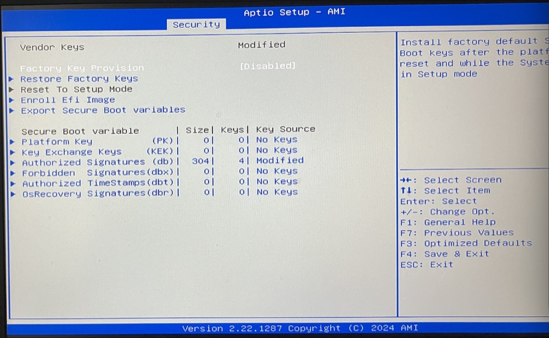
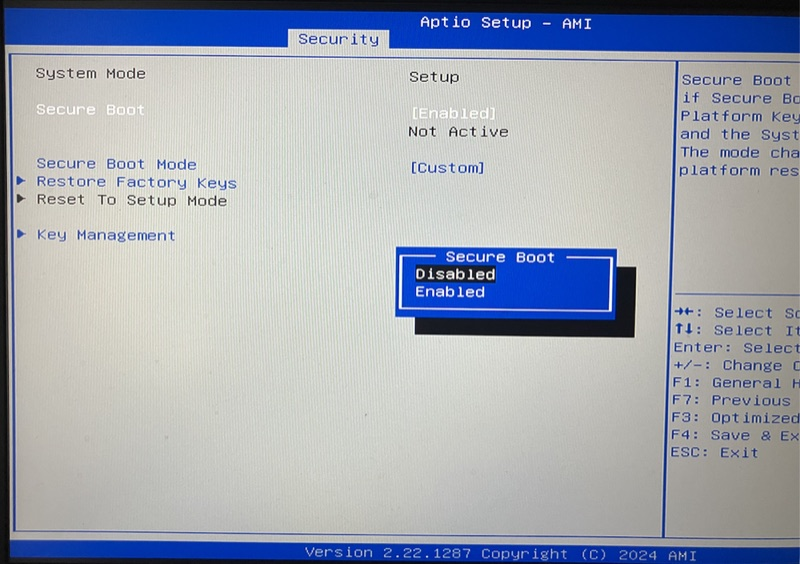
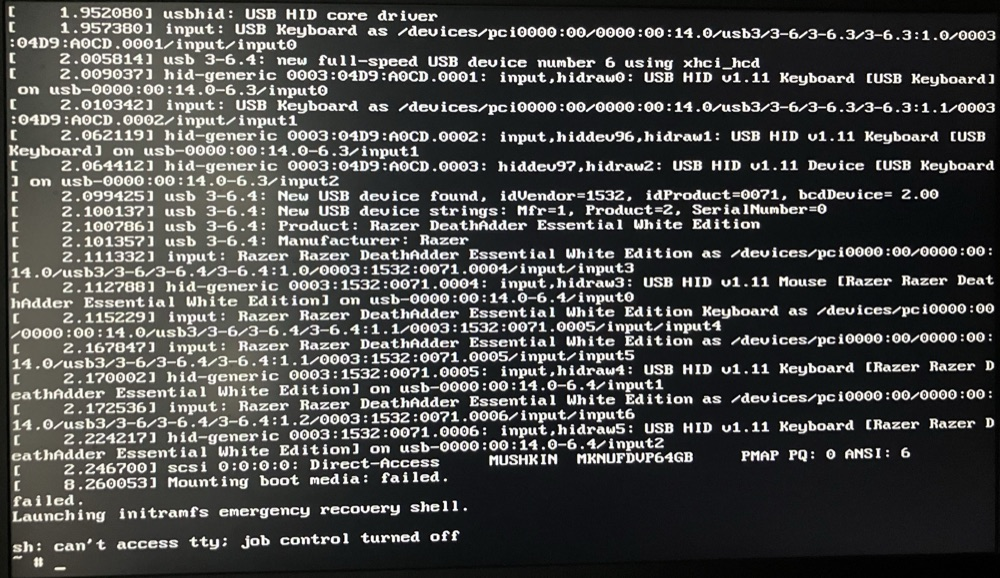
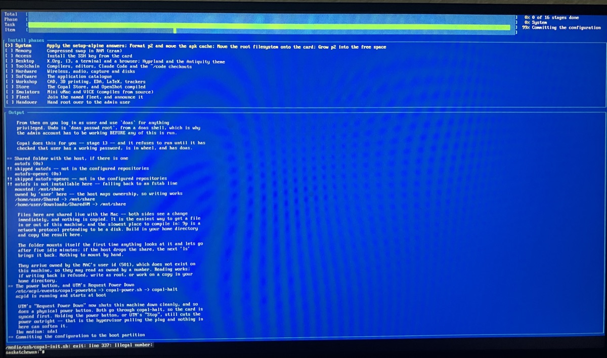
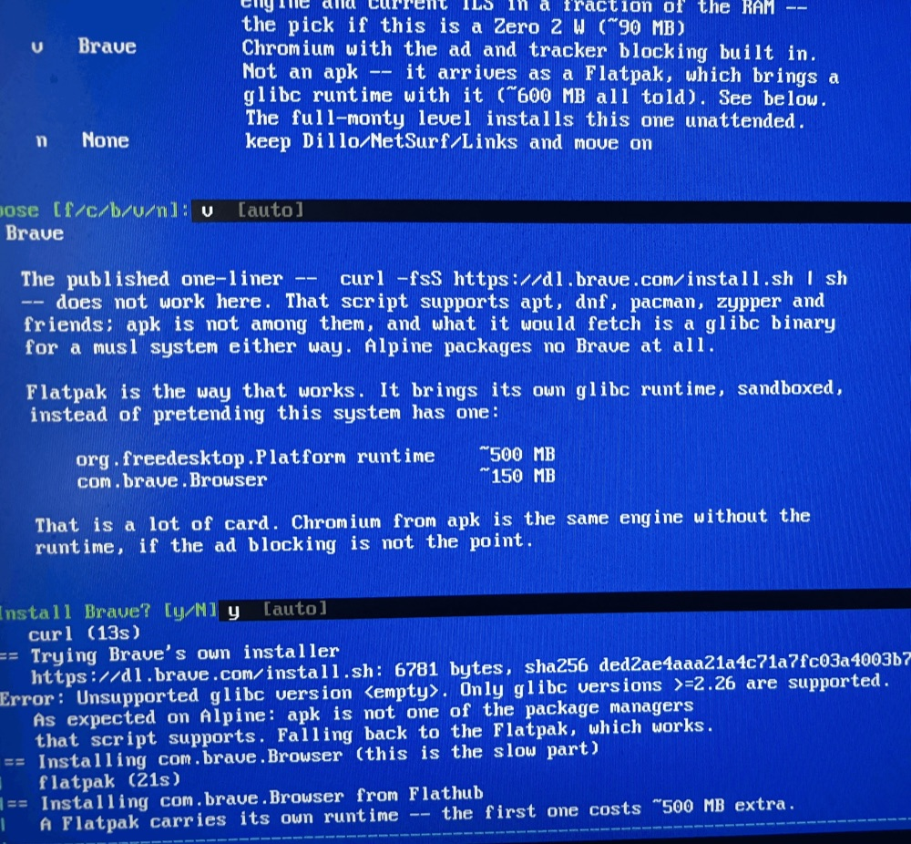

# Copal on a Real PC: Secure Boot, a Stick That Cannot See Itself, and a Save to the Wrong Place

*Lab Report — IEEE Format · interim, in progress*

<!-- SPDX-License-Identifier: MIT -->
Copyright (c) 2026 Paul Richeson. MIT licensed — see `LICENSE`. Copal Linux is
an aggregation of Alpine Linux, not a derivative work of it; Alpine and its
packages remain under their own licences.

---

## Abstract

Until now, Copal's x86_64 code path had only run under UTM, emulated on an
Apple Silicon Mac. This report records its first runs on physical hardware: a
64-bit Intel PC booted from a USB stick written by `make sd-pc`. It is kept as
a log, one attempt at a time, because each fix uncovered the next fault.

Five faults have been found so far, two of them on the Mac:

1. The checkout's `origin` had been pointed at the wrong repository, and a
   pull plus a rebase replaced Copal with copal-tm.
2. Secure Boot refused the stick, because the GRUB Copal places is unsigned.
3. On the Mac, the writer could not find where macOS had mounted the stick.
   `df` printed its columns in a shape the parser did not expect.
4. With Secure Boot off, GRUB and the kernel loaded, the kernel found the stick,
   and then `Mounting boot media: failed`. The cause is in Alpine's netboot
   initramfs, which Copal uses for PCs: it does not contain `sd_mod`, the SCSI
   disk driver that turns a detected USB stick into `/dev/sda`.

5. With the stick booting, the installer ran stage 1 to its last step and
   died saving the configuration (`lbu commit`). On a real PC, Alpine mounts
   any USB boot medium at `/media/usb`, but Copal named the medium after its
   device, `sda1`. In the VM the two names were both `vda1`. The failure was
   also hidden: the progress screen captured the error into a file in RAM,
   and the wrapper turned an empty exit status into
   `exit: line 337: Illegal number:`.

All five are fixed. For fault 4, Copal now takes `initramfs-lts` and
`modloop-lts` from Alpine's *standard* ISO, which is built to boot from local
disks. For fault 5, `lbu` is pointed at the medium's real mount point, and a
failed run now keeps its screen output in `copal.log` on the stick. One
detail of attempt 4 is still unexplained: why the exit status was empty and
not 1. Attempt 5, the boot that tests these fixes, is pending.

## I. Objective

1. Write a bootable Copal USB stick for an x86_64 UEFI PC from the Mac, using
   the repository's own target and not a hand-run `dd`.
2. Boot it on real Intel hardware and run the install stages to a desktop.
3. Record every place where real hardware behaves differently from UTM.

## II. Materials

| Item | Value |
|---|---|
| Writer | Apple Silicon Mac. First at `6d557cd`, then `514465c` plus the `copal-disk.sh` fix (III-C) |
| Target | `make sd-pc` → `MODEL=pc ./copal-prep.sh` |
| Stick | Mushkin `MKNUFDVP64GB`, USB, 63.3 GB, `/dev/disk4` on the Mac |
| Payload | `alpine-netboot-3.24.1-x86_64.tar.gz`, kernel `6.18.35-0-lts` |
| Bootloader | Alpine's GRUB, `efi/boot/bootx64.efi` from `alpine-virt-3.24.1-x86_64.iso`, 847,872 bytes, PE32+ |
| PC (attempts 1–6) | 64-bit Intel, UEFI, Intel xHCI at `0000:00:14.0`. *Make and model not yet recorded*. Seven disks: Windows on Disk 0, six empty NTFS volumes |
| PC (attempt 7) | *A different computer. Not yet recorded* |
| Firmware | AMI Aptio Setup, version 2.22.1287 (2024) |
| Disk initramfs | `initramfs-lts` and `modloop-lts` from `alpine-standard-3.24.1-x86_64.iso` (369,098,752 bytes, SHA-256 `f4dd6132…f51dd26`). From attempt 4 on |
| Peripherals seen at boot | USB keyboard `04D9:A0CD`, Razer DeathAdder Essential mouse `1532:0071` |

## III. The hunt, attempt by attempt

### A. Attempt 0 — `make sd-pc`: "no make target"

**Symptom.** `make: *** No rule to make target 'sd-pc'`.

**Cause.** The checkout had copal-tm's code in it, not Copal's. Its `origin`
pointed at `vonglurt/copal-tm`. The operator ran a `git pull`, which
force-updated `origin/main` to copal-tm's unrelated history, and a rebase then
moved `main` onto it. copal-tm's Makefile has no `sd-%` rule.

**Fix.** The Copal history (233 commits, tip `6d557cd`) was still in the
reflog. It was saved to a backup branch, and `main` was reset to it. Before the
reset the untracked files were checked against the restored tree, and none
collided.

During this step I said that `vonglurt/copal-alpine-linux` returned 404, and
that this Mac might hold the only copy of the work. That was wrong. The
operator pointed out that the repository is `copal`, and it had been moved to
the `copallinux` organisation, where GitHub held every local commit plus 119
newer ones. `origin` was repointed to `copallinux/copal` and `main` was
fast-forwarded to `514465c`. The backup branch was then deleted, along with
three copal-tm tags (`v0.1.2`–`v0.1.4`) that the bad pull had brought in.

### B. Attempt 1 — first boot: Secure Boot violation

**Symptom.** Written from `6d557cd`, the stick was refused by the PC's firmware
with a Secure Boot violation. *The exact message was not recorded.*

**Cause.** The GRUB binary has no signature at all. A UEFI binary carries its
Authenticode signature in the PE optional header's Certificate Table, which is
data directory entry 4. Read straight from the cached `BOOTX64.EFI`:

```
bytes 847872  PE32+  cert table size 0
```

`docs/copal-handbook.md` already says Secure Boot must be off ("the GRUB Copal
places is unsigned"). This was the first time real firmware enforced it.

**The firmware's view.** The operator photographed the Security pages
afterwards:





| Field | Value | What it means |
|---|---|---|
| Vendor Keys | Modified | The factory key set is no longer what is installed |
| Platform Key (PK) | 0 keys | No owner key. This is what puts the firmware in Setup Mode |
| Key Exchange Keys (KEK) | 0 keys | Nothing may update `db`/`dbx` with a signed request |
| Authorized Signatures (db) | 4 keys, 304 bytes, Modified | Four entries, none of them the factory certificates |
| dbx, dbt, dbr | 0 keys | No revocation list |
| System Mode | Setup | — |
| Secure Boot | [Enabled], **Not Active** | Switched on, but not enforcing |
| Secure Boot Mode | [Custom] | — |

Two readings follow from the table. The second is an inference, not
something the firmware states:

- **With no PK, Secure Boot is not enforcing.** UEFI only checks signatures
  in User Mode, which needs a Platform Key. "Enabled, Not Active" is the
  firmware saying exactly that. So in this state, the switch alone no longer
  decides whether the stick boots.
- **The four `db` entries are probably image hashes.** One SHA-256 hash in its
  own EFI signature list is 28 bytes of list header, a 16-byte owner GUID and
  the 32-byte hash: 76 bytes. 4 × 76 = 304, which matches exactly. That fits
  four uses of *Enroll Efi Image*, the "authorize the USB by loading the
  signatures manually" route the operator described, and it is too small to
  hold any certificate. The factory `db` (Microsoft's CA certificates among
  them) is gone.

The consequence is not obvious from the menus. **Restore Factory Keys** puts
PK, KEK and `db` back, which returns the firmware to User Mode, and from then
on Secure Boot enforces again. That is what Windows or any other
Microsoft-signed boot loader needs if this PC is to run one again with Secure
Boot on. It is also exactly what makes the firmware refuse Copal's GRUB, as in
attempt 1.

**Fix.** Turn Secure Boot off. In the second photo the option is being set to
*Disabled*. See V-A for why it has to stay off.

### C. Attempt 2 — rewriting the stick: the writer cannot find its own mount

**Symptom.** Run again at `514465c` to pick up the 119 newer commits,
`make sd-pc` partitioned the stick and then stopped at the boot-flag step:

```
error: expected /dev/disk4s1    7797248 2456   7794792     1%       0     0     -   /Volumes/COPALBOOT to be mounted after formatting
```

**Cause.** `macos_mount` in `tools/copal-disk.sh` read the mount point back
from `df` with a regex that strips a fixed run of numeric columns. On this Mac,
`df` prints `iused ifree %iused` after `Capacity`, and the FSKit FAT driver
prints `-` for `%iused`. The regex did not match, `sub()` changed nothing, and
the whole `df` line came back as the "mount point". The `[ -d "$MNT" ]` check in
`copal-prep.sh` then failed. Nothing had been copied to the stick, so nothing
was half-written.

**Fix.** Read the mount point from `diskutil info`, which reports it as a
single `Mount Point:` field, spaces included:

```sh
_m=$(diskutil info "/dev/$_p" 2>/dev/null | sed -n 's/^ *Mount Point: *//p')
```

Tested against the stick (`copal-disk.sh mount disk4 1` → `/Volumes/COPALBOOT`),
and `make lint` passes. The stick was then rewritten. *Uncommitted at the time
of writing.*

### D. Attempt 3 — Secure Boot off: `Mounting boot media: failed`

**Symptom.** GRUB loaded, the kernel loaded, and the boot dropped to the
initramfs emergency shell:



The relevant lines, transcribed:

```
[    2.246700] scsi 0:0:0:0: Direct-Access     MUSHKIN  MKNUFDVP64GB     PMAP PQ: 0 ANSI: 6
[    8.260053] Mounting boot media: failed.
failed.
Launching initramfs emergency recovery shell.

sh: can't access tty; job control turned off
~ #
```

**What is missing is one line.** On a working USB boot, the next message after
`scsi 0:0:0:0: Direct-Access` is
`sd 0:0:0:0: [sda] Attached SCSI removable disk`. It never comes. In the six
seconds the initramfs waits, the stick is a SCSI device that no driver has
claimed as a disk. There is no `/dev/sda`, so there is no partition to mount.
Everything before that point works: xHCI, the USB hub, HID, `usb-storage`, and
the SCSI core.

**Cause.** The initramfs was unpacked on the Mac from the cached netboot
tarball and its module list read:

| Module | In `initramfs-lts`? |
|---|---|
| `xhci-hcd`, `xhci-pci` | yes |
| `usb-storage`, `uas` | yes |
| `scsi_mod`, `scsi_common` | yes |
| `vfat`, `nls_cp437`, `nls_iso8859-1`, `nls_utf8` | yes |
| **`sd_mod`** | **no** |

It holds 347 modules, and `sd_mod.ko` is not one of them. It is not built into
the kernel either: the shipped `config-6.18.35-0-lts` says
`CONFIG_BLK_DEV_SD=m`. The netboot tarball's `apks/x86_64` (96 files) does not
carry a `linux-lts` package from which it could be loaded later.

This is a deliberate choice by Alpine, not a broken download. The netboot
initramfs exists to fetch its root over the network, and it never needs to read
a local disk. Copal uses it because it has the same `boot/` layout as the other
payloads (see the handbook's PC section). Until now, nothing has needed it to
read a USB disk. The x86_64 UTM machine never met this, because its disk is
`virtio_blk` (`/dev/vda`), which needs no `sd_mod`.

**A misreading worth recording.** On reading the diagnosis, the operator took
`sd_mod` to be a GRUB module they could disable. It is not. `sd_mod` is a
Linux kernel driver, and it is absent, not switched on. The fix is to *add*
it. Removing `sd-mod` from the `modules=` list on GRUB's `linux` line changes
nothing, because the initramfs cannot load a module it does not contain.

**Confirmation at the emergency shell.** Optional now that the fix is built,
but still worth a photo if the stick is booted again in its old state:

```sh
ls /dev/sd*         # expected: No such file or directory
modprobe sd_mod     # expected: module sd_mod not found in modules.dep
```

**The fix that was proposed.** First I proposed fetching
`linux-lts-6.18.35-r0.apk`, extracting `sd_mod.ko` from it, and loading it from
a second cpio archive alongside Alpine's initramfs. That would have worked,
but it needed `modules.dep` editing and a hand-maintained list of the
module's dependencies. It also needed a way to verify an `.apk` on macOS,
where the trust chain runs through a signed `APKINDEX` and not a published
SHA-256.

**The fix as built.** A closer look at the netboot initramfs showed that the
gap is wider than `sd_mod`. It has *no* local-disk driver at all: no `sd_mod`,
no `ahci` (SATA) and no `nvme`. It only has `virtio_blk` and `loop`. Alpine
builds a different initramfs for exactly the case Copal is in, a system booted
from its own media, and ships it in `alpine-standard`:

| | netboot `initramfs-lts` | standard `initramfs-lts` |
|---|---|---|
| `.ko` files | 347 | 374 |
| `usb-storage`, `vfat` | yes | yes |
| `sd_mod` | **no** | yes |
| `ahci` | **no** | yes |
| `nvme` | **no** | yes |
| `vmlinuz-lts` beside it | `77007123c0591ab4…` | `77007123c0591ab4…`, identical |

The kernels are byte-identical, so the standard initramfs's modules are built
for the kernel already on the stick. Its `modloop-lts` differs from
netboot's (`7c2acf3b…` against `871ef51e…`), and the initramfs carries the key
its modloop is verified against. So the two are taken together, as a pair
that was built together.

`fetch_disk_initramfs` in `copal-prep.sh` now runs after `fetch_bootloader`
for every `pc` build:

1. It fetches `alpine-standard-<ver>-<arch>.iso.sha256` every run, and the ISO
   only on a cache miss. It verifies the ISO the same way as every other
   payload, and refuses on a mismatch.
2. It extracts `boot/vmlinuz-lts`, `boot/initramfs-lts` and `boot/modloop-lts`
   with `bsdtar`, without mounting anything.
3. It refuses unless `vmlinuz-lts` is byte-identical to netboot's (`cmp`).
4. It refuses unless the initramfs's file list contains `usb-storage.ko`,
   `sd_mod.ko` and `vfat.ko`. This is the guard proposed in V-C, built.
5. It replaces `initramfs-lts` and `modloop-lts` in the payload. The `virt`
   files stay netboot's, because the VM entries are the ones that work.

`MODEL=pc ./copal-prep.sh --cache-only` ran it end to end:

```
==> Disk initramfs: initramfs-lts and modloop-lts, from alpine-standard-3.24.1-x86_64.iso
==> Disk initramfs: initramfs-lts has usb-storage, sd_mod and vfat; same kernel as netboot
```

The 32-bit `pc32` payload has the same gap: its netboot `initramfs-lts`
contains no `sd_mod`. Alpine publishes `alpine-standard-3.24.1-x86.iso`
(289 MB), and the function is written per architecture, so `pc32` gets the
same fix. It has not been booted on 32-bit hardware.

**A pre-existing fault found on the way.** `make lint` showed that
`copal-disk.sh`'s own self-test was failing on the Mac:
`SELF-TEST FAILED: card is whole`. The Linux backend's `probe` has a
`case … in disk|loop) …` inside `$( … )`. The bash 3.2 that macOS runs as
`/bin/sh` closes the command substitution at the pattern's `)`. A leading `(`
on each pattern, `(disk|loop)` and `(*)`, is valid POSIX and parses
everywhere. The self-test now passes: 59 checks, macOS backend. The fault was
in the Linux backend only and did not touch any stick written from the Mac.

### E. Attempt 4 — the stick boots; stage 1 dies at the commit

**Symptom.** Written with the standard-ISO initramfs, the stick **booted**.
The kernel attached it as a disk, the diskless system came up with hostname
`saskatchewan`, and the installer's TUI started stage 1 ("System"). It ran
through the setup-alpine answers, the admin account, the shared-folder and
power-button steps, and set the lbu medium. Then, at the commit, the TUI
vanished and the shell printed:



```
    lbu medium: sda1
== Committing the configuration to the boot partition
/media/usb/copal-init.sh: exit: line 337: Illegal number:
saskatchewan:~#
```

**What line 337 is.** It is not stage 1. It is the logging wrapper at the top
of `copal-init.sh`. The wrapper re-runs the script under `tee`, and has the
inner run write its exit status to a `mktemp` file:

```sh
{ sh "$0" "$@" 2>&1; echo $? > "$_rcfile"; } | tee -a "$LOG"
_rc=$(cat "$_rcfile" 2>/dev/null || echo 1)
exit "$_rc"          # line 337
```

`Illegal number:` with nothing after it means `$_rc` was empty. The file
existed, because `mktemp` made it, and `cat` succeeded, but nothing was ever
written to it. So `echo $?` never ran. The group running the inner script
ended without finishing, which points to a signal and not to a `die`. A `die`
would have exited non-zero and still written the status. The two lines that
follow `lbu commit -d` in stage 1, an `ls -l` of the apkovl and
"Stage 1 complete.", never appeared.

**Two faults, then.**

1. *The wrapper.* `exit ""` is a second failure that hides the first. An
   empty status should be reported as one ("the installer ended without
   reporting a status") and exit non-zero, not handed to `exit`. This one is
   certain, and it is a small fix.
2. *Whatever stopped the inner run at `lbu commit`.* Not yet known. Leading
   suspect: the installer runs from `/media/usb`, but `lbu_fix_media` set
   `LBU_MEDIA=sda1`, so `lbu` works on `/media/sda1`. If `lbu` mounts `sda1`
   a second time there, its remount or unmount afterwards acts on the same
   filesystem that `/media/usb` and `$LOG` live on. Under UTM the boot medium
   was mounted as `/media/vda1`, the same name as its device, so the two could
   not disagree. The standard initramfs, new in attempt 4, may be what mounts
   a USB boot medium at `/media/usb`. *Unconfirmed: the log and the mounts are
   needed.*

**Two oddities on the same screen, to check.** The shared-folder step reports
`mounted: /mnt/share`, owned by the host, on a physical PC that has no host.
The power-button note talks about UTM's "Request Power Down". Either the
VM-detection gate let a real machine through, or the messages are only
worded for a VM. *Unconfirmed.*

**Asked for at the PC, then overtaken.** I asked for the mounts, `lbu.conf`
and a manual `lbu commit`. Instead, the operator asked for the fix outright and
then brought the stick back to the Mac. The diagnosis below comes from
Alpine's own code and that stick.

**Diagnosis, from Alpine's code and the stick's log.**

1. *The medium name: confirmed.* The initramfs `init` is identical in netboot
   and standard. After `nlplug-findfs` mounts the boot medium,
   `remount_fstab_entry` looks the device up in the initramfs's `/etc/fstab`
   and *moves* the mount to whatever mount point that file gives for it.
   Alpine's `fstab` carries `/dev/usbdisk /media/usb vfat noauto`, and mdev
   points `/dev/usbdisk` at a USB disk's partition. So on any USB boot the
   medium ends up at `/media/usb`, while its device is `sda1`. The stick's
   `copal.log` agrees: `saved to /media/usb/copal-git`. A virtio disk is never
   `usbdisk`, which is why the VM never showed this.

   `lbu_fix_media` derived `LBU_MEDIA` from the *device* (`sda1`). `lbu commit`
   (alpine-conf 3.22.0) works on `/media/$LBU_MEDIA`. It calls
   `mount_once_rw /media/sda1`, and that fails because nothing is or can be
   mounted there. The stick has no `*.apkovl.tar.gz` on it: the commit never
   wrote one.
2. *Why the reason was invisible.* `die` takes the progress screen down but
   left stdout captured into the screen's Output file, so its
   `error: lbu commit failed` line went into that file. That file lives in
   `/tmp`, in RAM, and is copied into `copal.log` only by a run that finishes.
   The log on the stick ends at setup-alpine's `Disk & Install` heading. Every
   word the stages printed after that is gone.
3. *The empty status: still unexplained.* A `die` exits 1 and the wrapper
   would have read `1`. An empty status file means the inner run did not reach
   `echo $?` at all. Nothing found so far accounts for that. The fixes below
   are written so that, if it happens again, the cause is in `copal.log` and
   not lost.

**Fixes, all in `copal-prep.sh` (the generated `copal-init.sh`):**

| Fault | Fix |
|---|---|
| `LBU_MEDIA=sda1` on a USB boot | `lbu_fix_media` takes the name from where `$BOOT` is mounted under `/media` (`usb`). A Pi (`mmcblk0p1`) and a VM (`vda1`) get the same names as before. `find_boot`'s temporary `/media/copal-boot` keeps the device name, because it is in no fstab |
| `die` invisible under the progress screen | `die` calls `tui_capture_off` before `tui_end`, so the error reaches the terminal and the log |
| The screen's output lost on a failed run | On any non-zero or empty status, the wrapper appends `/tmp/copal.*/copal-tui-out` to `copal.log`, prints its last 25 lines, and removes it |
| `exit: Illegal number:` | An empty or non-numeric status is reported as "ended without reporting a status (killed?)" and exits 1 |
| Shared folder set up on a real PC | `configure_9p_share` returns early when `is_vm` is false. The quiet boot-time retry stays installed. "mounted" is now decided by `mountpoint`, not by `mount`'s exit status |
| UTM wording on real hardware | The power-button note is worded for a physical machine when `is_vm` is false. The setting itself was already right |

`make lint` passes: `copal-init.sh` parses under dash and defines every helper
it calls. The medium-name logic was checked against `/media/usb`,
`/media/vda1`, `/media/mmcblk0p1`, `/media/copal-boot` and `/boot`.

### F. Attempt 5 — past stage 1, into the desktop

**Progress.** Written with the attempt 4 fixes, the stick booted and the
installer got past the System phase. The phase that died in attempt 4 is now
behind it. The next photo comes from the Desktop phase, at the browser
choice, which the full-monty level answers with Brave (`v`).

**"Error: Unsupported glibc version <empty>" is expected.** It is not a fault:



```
== Trying Brave's own installer
   https://dl.brave.com/install.sh: 6781 bytes, sha256 ded2ae4aaa21a4c71a7fc03a4003b7…
Error: Unsupported glibc version <empty>. Only glibc versions >=2.26 are supported.
   As expected on Alpine: apk is not one of the package managers
   that script supports. Falling back to the Flatpak, which works.
== Installing com.brave.Browser (this is the slow part)
```

Alpine is built on musl, not glibc, and Brave publishes only glibc builds.
`install_brave` tries Brave's own script first on purpose, in case a later
version learns to handle apk. It saves the script to a file and logs its
size and sha256. It then judges the result by whether a `brave` command
exists, not by the script's exit status. The script found no glibc (the
version it read is empty), printed its error, and the installer moved on to
the Flatpak, which brings its own glibc runtime (~650 MB in all). This is the
route the handbook documents, and it is the same on every Copal machine,
VM included.

The only cost is a line that starts with `Error:` in the middle of a healthy
install. Skipping Brave's script when the system has no glibc would remove
it. That is a cosmetic change and is left as an open item.

*Pending: whether the Flatpak install completes, and how far the rest of the
run gets.*

### G. Attempt 6 — a machine with five drives and no network

**Setting.** The stick was rewritten and booted on a PC with several hard
drives. The stick came up as `sdf`, so `sda`–`sde` are other disks. The
operator reported a failure and brought the stick back to the Mac.

**What the stick says.**

| Evidence | Reading |
|---|---|
| `copal.log`: `udhcpc failed to get a DHCP lease`, `ntpd: bad address 'pool.ntp.org'`, `wget: bad address 'mirrors.alpinelinux.org'`, `Warning! No mirror found` | No network. setup-alpine configured no remote mirror |
| `saskatchewan.apkovl.tar.gz` present; `lbu.conf` has `LBU_MEDIA=usb` | **Stage 1 completed and saved: the attempt 4 fix works** |
| `fstab` in the apkovl: `UUID=0cc9f010-… /media/sdf2 ext4` | Stage 2 formatted the stick's p2 as ext4. `e2fsprogs` came from the boot medium's own repository, with no network needed |
| `copal-auto`: `DONE= 1 2 3`; `copal-timings`: `START 3` with no `END` | Stage 3 began and never finished |
| `boot/grub/grub.cfg.bak` written at 16:25, identical to `grub.cfg` | Stage 3 got past its network check to the backup, the step just before `mkfs.ext4` and `setup-disk` |
| On the Mac, the stick's p2 no longer mounts and has lost its name | Consistent with ext4 on it now |

The progress screen's output is not in `copal.log`. Nothing was written to
the stick after 16:25, so the wrapper's copy-on-failure never ran. The run
was most likely ended by switching the machine off at the failure screen.

**Fault: the network check passes with no network.** `require_network`
was `apk update`, and that succeeds if *any* repository answers. The boot
medium's `apks/` is one, so on a machine with no cable it reported "ok".
Stage 3 then reformatted p2 and ran `setup-disk`, which installs
`linux-lts` from a mirror that did not exist. Stage 3 is the destructive
stage, so a false "ok" there is the worst place for one.

**Fix.** `require_network` takes each `http(s)://` line in
`/etc/apk/repositories`, asks it for `APKINDEX.tar.gz` (`wget --spider`,
15-second timeout), and passes only if one answers and `apk update`
succeeds. With no remote line at all, it says so, and names
`setup-apkrepos -1` as the repair.

**The other drives.** Copal derives the disk it writes to from the boot
medium (`BOOTDEV` → `DISKDEV` → `P1`/`P2`), never from a list of disks, so
`sda`–`sde` are outside its reach by construction. But the log could not
*show* that, because nothing recorded which disks were present. `log_disks`
now writes every block device to the log at the start of each automatic
install: name, size, removable flag and model, with the boot medium marked
as the only disk Copal writes to. It reads `/sys` and needs nothing beyond
busybox.

**Not proven from the Mac.** That the ext4 UUID on the stick's p2 is
`0cc9f010…`. macOS would not let an unprivileged read of `/dev/rdisk4s2`
check it. The stick's p2 losing its FAT filesystem is the strong evidence.

**Next.** Fix the cable, rewrite the stick, and start clean. A resume would
skip stages 1–3, which are marked attempted, and stage 1's missing mirror
would stay missing.

### H. Design — root on one of the PC's own disks

**Why.** Until now a Copal PC was the stick: root on its p2, the PC's own disks
never touched. The machine in attempt 6 has seven disks. The operator's
Windows screenshot shows them: Disk 0, 1863 GB, holding Windows (EFI, `C:`
about 160 GB used, Recovery), and six NTFS data volumes that are effectively
empty (119, 1907, 119, 1863, 931 and 3726 GB). They asked for an install that
can use them: the first disk should be the NVMe/M.2, ZFS and Btrfs
(especially mirrored) pushed down, existing volumes mounted at the end,
warnings for a wrong choice, root taking a whole disk, a smaller disk offered
for swap, and boot files that survive a disk swap.

**Decisions put to the operator** (2026-10-22):

| Question | Answer |
|---|---|
| A disk holding an operating system (Windows on Disk 0) | Treat it like any disk. It is marked "Windows boots from here", and erasing it still needs the typed confirmation |
| Where the boot files live when root is on an internal disk | Copy them to an EFI partition on the root disk, so the PC boots without the stick |
| How the root disk is chosen in full-automatic mode | Asked at the PC; the stick is the default |
| Existing filesystems on the other disks | Data read-write, OS volumes read-only; ZFS and RAID members listed, not mounted |

**As built.** New helpers in `copal-prep.sh`, outside the generated stages
region: `choose_root_target`, `root_candidates`, `disk_survey`,
`prepare_root_disk`, `prepare_swap_disk`, `register_efi_boot` and
`mount_existing_volumes`. Stage 3's playbook
(`playbooks/Stages/03-stage-sys-install.sh`) calls them, and is synced into
`copal-prep.sh` with `make sync-playbooks`.

1. **Survey.** Each whole disk in `/sys/block`, except the stick, loop, zram
   and md devices, is classed NVMe, SSD/eMMC, HDD or USB, and probed with
   util-linux `blkid -p`. That reads the device, not a cache, and recognises
   `zfs_member` and `linux_raid_member`. Its presence is checked by
   `blkid -V`, because busybox's blkid accepts `-p` and silently ignores it,
   which would make a ZFS member read "empty". An EFI partition is mounted
   read-only to see whether Windows Boot Manager is on it.
2. **Order.** Unmarked disks first, NVMe, then SSD, then HDD, then USB, and
   smallest first within each. Disks holding ZFS, RAID, LVM, LUKS, bcache or
   Btrfs are marked `!!` and sorted below them. Disks under 16 GiB are listed
   but cannot be chosen. The stick is the default, `s`.
3. **The question** is read from `/dev/tty`, past `ask()`, so full-automatic
   mode cannot answer it. With no terminal, or no other disks, root stays on
   the stick.
4. **Warnings.** Typing a partition (`sdb1`, `nvme0n1p2`) gets "root takes a
   whole disk here -- choose sdb". Choosing a disk shows its partitions and
   warns, as they apply, that everything on it is destroyed, that it belongs
   to a pool or array, that Windows boots from it, that it is a spinning disk
   while an SSD is free, that it is the largest disk (usually the data disk),
   or that it is USB. The erase needs the disk's name typed back.
5. **Root disk layout.** `wipefs`, then a GPT laid out by `sfdisk`: p1 a 2 GiB
   EFI partition (FAT32, `COPALBOOT`), p2 ext4 (`COPALROOT`) for the rest.
   The stick's p1 holds 457 MB, so 2 GiB leaves room for kernels. GPT, not
   MBR, because one of these disks is 3.7 TB.
6. **Boot.** The stick's boot partition is copied onto the new p1: GRUB, the
   diskless payload, `answers.txt` and the install's state. `P1`/`P2` are then
   repointed at the new disk, so the rest of stage 3 is the same code as
   before: `setup-disk`, `root=UUID=` in the new p1's `grub.cfg`, the checks.
   `efibootmgr` puts a "Copal Linux" entry first in the boot order. The stick
   is never changed, so it still boots the diskless system if anything fails.
7. **Swap.** The smallest unmarked internal disk left over is offered: one
   swap partition the size of RAM (2–32 GiB), the rest unallocated, with
   `pri=10` so zram is used first.
8. **Existing volumes.** Every other filesystem gets an fstab line under
   `/mnt/disks/<label>`, always `nofail`. NTFS goes through the kernel's
   `ntfs3`, read-write and owned by the admin user, except read-only where
   `Windows/System32` exists, or where it cannot be read (often Windows Fast
   Startup's hibernation). EFI partitions, swap, ZFS, RAID, LVM, LUKS and
   multi-device Btrfs are listed and left alone. Nothing is written to any
   of them.

**Checked so far.** `make lint`: the generated `copal-init.sh` parses under
dash and defines every helper it calls, and the playbooks are in step. The
partition-to-disk mapping, the swap pick, the "faster disk" hint, the
largest-disk test, label sanitising and the table layout were run against
sample data. Not yet run on real disks.

**Note for the operator.** The firmware's Secure Boot keys are already
cleared (III-B). If Windows on Disk 0 is kept and Copal goes elsewhere, the
"Copal Linux" entry goes first in the boot order, and Windows Boot Manager
stays reachable from the firmware's boot menu.

### I. Attempt 7 — a different computer

**Setting.** The stick is rewritten from `d68cf16`, which has the disk
choice (III-H) and the network check that needs a remote mirror (III-G). It
is being booted on a **different computer** from attempts 1–6. That makes
this the first run of the new code on real disks, and also the first time
the stick meets a second, unrelated set of PC hardware: firmware, network
adapter, graphics and disk controllers.

*To record:* the machine's make and model, its firmware and Secure Boot
state, its disks as `log_disks` lists them, the disk choice stage 3 offered
and the one taken, whether the network came up, and how far the run got.
`copal.log` on the stick will hold the disk list and, if the run stops, the
progress screen's output.

## IV. Results so far

| Attempt | Stage reached | Result |
|---|---|---|
| 0 | Mac, `make` | No target. Wrong repository checked out. Fixed |
| 1 | PC firmware | Secure Boot violation. Secure Boot turned off |
| 2 | Mac, writing | Mount point not found. `copal-disk.sh` fixed |
| 3 | PC initramfs | Stick detected, never attached as a disk: no `sd_mod`. Initramfs taken from `alpine-standard`. Fixed on the Mac |
| 4 | Stage 1, `lbu commit` | **Booted.** Stage 1 failed at its last step: `LBU_MEDIA=sda1` while the stick was at `/media/usb`. Fixed, with the failure path made visible |
| 5 | Desktop phase, Brave | **Stage 1 fixed: the System phase completed.** Brave's glibc error is expected; the Flatpak fallback ran |
| 6 | Stage 3, `setup-disk` | Five-drive PC, no network. The network check passed on the stick's own repository. Fixed, and a disk list is now logged |
| 7 | — | *Pending: a different computer; first run of the disk choice (III-H) on real disks* |

## V. Discussion

### A. Three ways past Secure Boot

| Route | Works for the live stick | Works after install | Cost |
|---|---|---|---|
| 1. Turn Secure Boot **off** and leave it off | Yes | Yes | The firmware no longer checks what it boots |
| 2. Turn it off to install, then **back on** | Yes | **No** | The stick stops booting the moment it is re-enabled |
| 3. Enrol the stick's hash ("authorize from file") | Probably not | Probably not | Repeated on every GRUB update |

**Route 2 is the one to be careful of.** It assumes the install would replace
the unsigned bootloader with a signed one. It does not. Stage 3 runs
`BOOTLOADER=none setup-disk`, which leaves the GRUB already on the stick's ESP
in place and only rewrites `grub.cfg`. The installed machine boots through the
same unsigned `BOOTX64.EFI` it was installed from.

**Route 3 is plausible but untested.** Enrolling the hash in `db` may get
GRUB past the firmware. But GRUB 2.04 and later, under Secure Boot, verify the
kernel through shim's `shim_lock` protocol, and Copal ships no shim. The hash
also changes with every GRUB release. The proper route is a unified kernel
image signed with the owner's own keys (`sbctl`), which is a project in its
own right.

**Recommendation for this machine:** route 1.

### B. The internal drive does not need formatting

The operator's plan was to move data off the PC so its drive could "be
formatted into Copal Linux." That is not what a Copal PC install does. Stage 3
formats `p2` *of the boot media* and runs `setup-disk` into it. No stage writes
to the PC's internal drive, and the finished system is the stick. Backing up
before experimenting with firmware settings is still sensible, but formatting
the drive gains nothing.

### C. What UTM could not have caught

Each of attempts 1 and 3 failed on something the emulated x86_64 machine
cannot reproduce. UTM's firmware has Secure Boot off, and its disk is virtio,
not USB mass storage. The VM proves the installer's logic, not its boot path
on real hardware. The guard for fault 4 is now a build-time check that lists
the initramfs and refuses to write a `pc` stick whose ramdisk lacks
`usb-storage`, `sd_mod` and `vfat`. Had it existed, it would have caught this
on the Mac, before any PC was involved.

## VI. Open items

1. Rewrite the stick and boot it (attempt 5). If stage 1 stops again, the
   progress screen's output is now in `copal.log` on the stick. In particular,
   look there for why the status came back empty (III-E, item 3).
2. Commit the changes: `fetch_disk_initramfs`, the two `copal-disk.sh` fixes,
   the handbook paragraph, and this report.
3. Record the PC's make and model, the exact Secure Boot message from
   attempt 1, and which `grub.cfg` entry was booted.
4. Boot to a login prompt, then run stages 1–3 and record what real hardware
   does differently from UTM: network driver, graphics, `nvme`/`sda` naming.
5. Before this PC runs anything that needs Secure Boot again, use *Restore
   Factory Keys* (III-B).
6. Cosmetic: skip Brave's `install.sh` on a system with no glibc, so a healthy
   install does not print `Error:` (III-F).
7. Optional: a Secure Boot route using sbctl and a signed UKI (V-A). It would
   go into the PK/KEK/`db` that are empty now.

## VII. Conclusion, so far

The PC path had been tested only on an emulator that shares none of its
hardware. The first real machine found two faults in three attempts, and both
are at the boot boundary. The firmware will not run an unsigned GRUB, and the
initramfs Copal borrowed from Alpine's netboot payload has no driver for any
local disk. The first is a setting, and this machine's firmware is now in
Setup Mode with its factory keys removed, which will matter later. The second
is fixed by taking the one file Alpine builds for this purpose, from the
standard ISO. A check in the build now means a stick like this one cannot be
written again.
